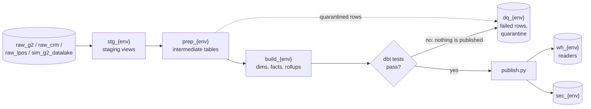

# POC C: dbt Transformation Layer (simple guide)

Part of POC 2 (Store Alert Data Lake). Sources: the approved plan
[GKS-POC-Phase2-detailed-plan.md](../GKS-POC-Phase2-detailed-plan.md) (mainly sections 4, 8, 10, 13) and the files in
[dbt/](../../dbt/) and [orchestration/publish/](../../orchestration/publish/).

---

## 1. What is dbt and why are we using it?

**dbt** turns raw tables into clean, tested tables. You write a `SELECT` in a `.sql` file. dbt creates the table,
works out the build order, runs the tests and records where the data came from.

**Why POC 2 needs it**

- Data arrives live as raw change logs (every change is a new row). Someone must turn that into "the current
  state" of each alert, store and device.
- Business rules (who is a customer, what is an open alert) must exist in **one** place.
- We must prove the data is right, so every table gets tests.
- POC 1 did this in Python. POC 2 rebuilds it in dbt under the story's table names and proves the result is the same.

**dbt instead of Python?**

| Python transforms                      | dbt                                                         |
| -------------------------------------- | ----------------------------------------------------------- |
| Logic hidden inside code               | Plain SQL, one file per table                               |
| Tests written by hand                  | Tests declared in a `.yml` next to the model                |
| Build order managed by hand            | Order worked out from `ref()` links                         |
| No lineage                             | Lineage and docs generated automatically                    |
| Column types can change by accident    | Model contracts stop that (enabled on `build` models)       |

**Where it fits.** The sources land raw data in BigQuery (Datastream, Pub/Sub, the CRM loader). dbt is the
"T" in ELT: it reads those raw tables and builds the clean ones inside BigQuery. We do not move data out to Python.

---

## 2. Overall data flow

```
raw data → dbt staging → dbt intermediate → dbt build → validations → publish.py → warehouse
```

| Step               | What happens                                                                                             |
| ------------------ | -------------------------------------------------------------------------------------------------------- |
| **Into dbt**       | Raw tables: `raw_g2` (G2 database changes), `raw_crm` (CRM exports), `raw_lpos` (case events), `sim_g2_datalake` (wheels) |
| **Staging**        | Rename, cast types, keep only the latest row per key                                                     |
| **Intermediate**   | Join tables, assign the tenant, flag or quarantine bad rows                                              |
| **Build**          | Final dimensions, facts and rollups, plus tests (the "audit" step)                                       |
| **Out of dbt**     | Tested tables in `build_{env}`. Failing rows in `dq_{env}`                                               |
| **publish.py**     | Copies `build_{env}` into `wh_{env}` in one transaction, only if dbt passed                              |



---

## 3. Project structure

Folder: [dbt/](../../dbt/).

```
dbt/
├── dbt_project.yml
├── profiles.yml
├── packages.yml
├── requirements.txt
├── README.md
├── Dockerfile
├── entrypoint.sh
├── models/
│   ├── sources/           sources.yml
│   ├── staging/           g2/  crm/  lpos/  g2_datalake/
│   ├── intermediate/      tenant/  alert/  crm/
│   ├── marts/             core/  calendar/  crm/  lpos/  wheel/
│   ├── rollups/
│   └── security/
├── macros/                generate_schema_name, is_customer, is_open_alert, tokenize, cdc_current_state, lineage_columns
├── seeds/                 map_customer_type.csv, status.csv, seeds.yml
├── tests/                 dq41_no_personal_data_columns.sql
└── analyses/
```

| File / folder           | What it does                                                                                                      |
| ----------------------- | ----------------------------------------------------------------------------------------------------------------- |
| `dbt_project.yml`       | Project settings. Sets each folder's dataset (`stg`, `prep`, `build`, `dq`), materialization, contracts, `store_failures`, and variables (`future_tolerance_minutes: 5`, `pii_deny_columns`) |
| `profiles.yml`          | How dbt connects to BigQuery. Four targets: `local`, `ci`, `dev`, `int`. Region `us-central1`                     |
| `packages.yml`          | Extra dbt packages: `dbt_utils` and `dbt_expectations`                                                            |
| `requirements.txt`      | Python versions for dbt: `dbt-core` and `dbt-bigquery` 1.9.x                                                      |
| `models/`               | The SQL models, one `.sql` and one `.yml` (description and tests) per model                                       |
| `models/sources/sources.yml` | Declares the raw tables dbt reads and their freshness limits                                                 |
| `macros/`               | Reusable SQL. See the table below                                                                                 |
| `seeds/`                | Small CSV lookups loaded as tables: `map_customer_type` (CRM type code to customer or not) and `status`           |
| `tests/`                | Custom SQL tests, named after the check (for example `dq41_no_personal_data_columns.sql`)                         |
| `Dockerfile`            | Builds the image for the Cloud Run job                                                                            |
| `entrypoint.sh`         | The job's commands: `microbatch`, `fullload` and `dbt <args>`                                                     |

**Macros**

| Macro                  | Purpose                                                                                       |
| ---------------------- | --------------------------------------------------------------------------------------------- |
| `generate_schema_name` | Builds the right dataset name for each environment (section 7)                                |
| `cdc_current_state`    | From the append-only change stream, keeps the newest row per key and a soft-delete flag       |
| `is_customer`          | The only place that decides who is a customer: type `CUSTOMER` and status `Active`            |
| `is_open_alert`        | The only place that decides an alert is open: not resolved and not deleted                    |
| `tokenize`             | Turns personal values into a keyed-hash token (key from `keys.token_key`)                     |
| `lineage_columns`      | Adds `_source_system`, `_source_updated_at`, `_dbt_loaded_at`, `_dbt_invocation_id`           |

**Other important files outside `dbt/`**

| File                                                   | Purpose                                                                    |
| ------------------------------------------------------ | -------------------------------------------------------------------------- |
| [orchestration/publish/tables.yaml](../../orchestration/publish/tables.yaml) | Tells `publish.py` how to publish each table (kind, partition column, tenant-scoped or not) |
| [orchestration/publish/objects/mv_alert_trend_daily.sql](../../orchestration/publish/objects/mv_alert_trend_daily.sql) | SQL for a native materialized view |
| `orchestration/publish/publish.py`                     | The write-audit-publish script                                             |
| `orchestration/*.workflow.yaml`                        | Micro-batch, full-load and watchdog workflows                              |
| [cloudbuild/](../../cloudbuild/)                       | CI/CD for dbt                                                              |

---

## 4. Transformation stages

Each stage writes to its own dataset. `{env}` is `dev` or `int`.

### Staging: `stg_{env}` (views)

**Job:** clean the source: rename, cast types, keep the latest row per key (so duplicates go away), mark deletes.

```sql
-- models/staging/g2/stg_g2__stores.sql  (the whole file)
{{ cdc_current_state(source('raw_g2', 'g2_stores'), ['store_id']) }}
```

The CRM version does the same with `qualify row_number() ... order by export_ts desc = 1` and casts ids to
`string` (`stg_crm__account.sql`).

### Intermediate: `prep_{env}` (tables)

**Job:** join tables, assign the tenant, apply business rules, validate rows.

```sql
-- models/intermediate/alert/int_alert__validated.sql (shortened)
if(dl.device_id is null or st.store_id is null, 'DQ33_UNKNOWN_DEVICE_OR_STORE', null),
...
if(reasons = '', 'PASS', 'QUARANTINE') as _dq_status
```

Other models here: `int_account__tenant` (finds the top-level account = tenant, up to 3 parent levels) and
`int_store__tenant` (tenant per store).

### Build: `build_{env}` (tables)

**Job:** the final dimensions, facts and rollups. Facts are partitioned and clustered. `build` models have enforced
contracts. Seeds also land here.

```sql
-- models/marts/core/fct_alert.sql (shortened)
{{ config(partition_by={'field': 'alert_date', 'data_type': 'date'},
          cluster_by=['tenant_id', 'store_id', 'device_id']) }}
select ..., {{ tokenize('i.assignee_user_id') }} as assignee_token
from {{ ref('int_alert__validated') }} as i
where i._dq_status != 'QUARANTINE'
```

### DQ: `dq_{env}`

**Job:** keep the evidence. Every test stores its failing rows here (`store_failures: true` and `+schema: dq` in
`dbt_project.yml`). The model `quarantine_alert` also lives here.

```sql
-- models/intermediate/alert/quarantine_alert.sql
{{ config(schema='dq', materialized='table') }}
select * from {{ ref('int_alert__validated') }} where _dq_status = 'QUARANTINE'
```

### Security: `sec_{env}`

**Job:** hold `map_tenant_access` (which person or app may see which tenant). The row access policies on the
published tables read it.

- The model goes in `models/security/`. Its source is `g2.store_access`.
- dbt builds it into `build_{env}` like everything else. `publish.py` then copies it to `sec_{env}` in the same
  transaction as `wh_{env}`. dbt never writes to `sec_{env}`.

---

## 5. Tables and their purpose

Every table has `tenant_id`, except `dim_date` and `dim_alert_type`. "Key tests" means `unique` and `not_null` on the
key column(s) from the model's `.yml`.

| Table                   | Purpose                                                         | Source                                           | Validations                                                                 |
| ----------------------- | --------------------------------------------------------------- | ------------------------------------------------ | --------------------------------------------------------------------------- |
| `dim_store`             | Stores with brand and tenant                                    | `stg_g2__stores`, `stg_g2__brands`, `int_store__tenant` | Key tests; DQ37 (no tenant if no active CRM store)                    |
| `dim_device`            | Devices and their store                                         | `stg_g2__device_locations`, `int_store__tenant`  | Key tests                                                                   |
| `dim_alert_type`        | Alert type lookup                                               | `stg_g2__alert_types`                            | Key tests                                                                   |
| `dim_date`              | One row per day, 2024-01-01 to 2027-12-31                       | `dbt_utils.date_spine`                           | Key test on `date_day`                                                      |
| `fct_alert`             | One row per alert incident (soft deletes kept, quarantined rows removed) | `int_alert__validated`, `int_store__tenant`, `stg_g2__users`, `stg_g2__teams` | Key tests; DQ33, DQ34, DQ38 (upstream); DQ41 |
| `fct_alert_history`     | Status changes of each alert                                    | `stg_g2__alert_history`, `fct_alert`             | Key tests; `incident_id` must exist in `fct_alert`                          |
| `dim_account`           | CRM accounts and the customer flag (also used by `int_store__tenant`) | `stg_crm__account`, `map_customer_type`, `int_account__tenant` | Key tests; DQ36 (unknown type becomes `UNKNOWN`)               |
| `fct_case`              | One row per case, latest event                                  | `stg_lpos__case_event` (`raw_lpos`)              | DQ35                                                                        |
| `dim_offender`          | One row per tenant and offender token                           | Case events                                      | Key tests                                                                   |
| `dim_wheel`             | One row per cart wheel                                          | `sim_g2_datalake.wheel`                          | Key tests                                                                   |
| `fct_wheel_event`       | One row per wheel event                                         | `sim_g2_datalake.wheel_event`                    | DQ43                                                                        |
| `fct_work_order`        | One row per CRM work order                                      | `int_crm__work_order` (`raw_crm`)                | Key tests                                                                   |
| `mv_store_health`       | Store colour, reason, owner. A dbt table                        | Alert facts and the health-rule seed             | Golden scenarios                                                            |
| `mv_incident_health`, `mv_current_issues`, `mv_downtime_interval` | Supporting store and alert marts (dbt tables) | Alert facts                       | Key tests                                                                   |
| `mv_alert_trend_daily`  | Alerts per tenant, store and day. Native view in `wh`; a dbt version stays in `build` | `fct_alert`            | Compared with its dbt version                                               |
| `mv_alert_trend_weekly` | Weekly version of the trend (dbt table)                         | Alert facts                                      | Key tests                                                                   |
| `mv_cart_count_daily`   | Wheel events and exit attempts per day. Native view in `wh`; a dbt version stays in `build` | `fct_wheel_event` | Compared with its dbt version                                               |

---

## 6. Data validations

| DQ   | What is checked                                                  | What happens when it fails                                      | Where |
| ---- | ---------------------------------------------------------------- | --------------------------------------------------------------- | ----- |
| DQ33 | Alert names a device or store we do not know                     | **Critical.** Row is quarantined (`dq_{env}.quarantine_alert`), kept out of facts | `int_alert__validated` |
| DQ34 | Event time is more than 5 minutes in the future (`future_tolerance_minutes`) | **Critical.** Row is quarantined                  | `int_alert__validated` |
| DQ35 | Duplicate case `event_id`                                        | **Warning.** Removed in staging, count reported                  | `stg_lpos__case_event` |
| DQ36 | CRM account with an unknown type code                            | **Warning.** Type becomes `UNKNOWN`, not a customer              | `dim_account` |
| DQ37 | Store has no active CRM store record                             | **Warning.** `tenant_id` is null, store is internal-only         | `int_store__tenant` |
| DQ38 | Alert resolved before it opened                                  | **Critical.** Row is quarantined                                 | `int_alert__validated` |
| DQ39 | Incremental facts differ from the daily full rebuild             | **Error**, to be explained. Count written to `ops_{env}.dq_result` | Daily full load |
| DQ40 | No new CRM export in 75 minutes                                  | **Freshness error**, alert                                       | `freshness_check` |
| DQ41 | Personal data in the warehouse: a deny-listed column name or an email-like value | **Error.** Fails the build                    | `tests/dq41_no_personal_data_columns.sql`; daily scan |
| DQ42 | More than half of the CRM accounts change in one export          | **Error.** Export is held, alert. **Handled by the Python CRM loader (`poc-crm-loader`), not by dbt** | CRM loader |
| DQ43 | Wheel event names an unknown wheel                               | **Warning.** Row kept, flagged                                   | `fct_wheel_event` test |

**The four terms, in plain words**

| Term                       | Meaning                                                                                                   |
| -------------------------- | --------------------------------------------------------------------------------------------------------- |
| **Error / critical**       | Serious. For row rules (DQ33, DQ34, DQ38) the row is quarantined. For test errors (DQ41) the dbt build fails, so nothing is published |
| **Warning**                | The row stays. It is flagged or given a safe value (`UNKNOWN`, null tenant) and counted                   |
| **Quarantined records**    | Bad alert rows removed from the facts and kept in `dq_{env}.quarantine_alert` with `_dq_reasons`          |
| **Failed test records**    | Any dbt test that fails saves its failing rows in `dq_{env}` (`store_failures`). This is about tests, not about quarantine |

---

## 7. Environments

| Environment | Purpose                                                       | Dataset names (examples)                                                              |
| ----------- | ------------------------------------------------------------- | ------------------------------------------------------------------------------------- |
| **Local**   | A developer builds on a laptop with their own Google login. Never writes to `build_dev` or `wh_dev` | `dbt_<DBT_USER>_stg`, `_prep`, `_build`, `_dq`                |
| **CI**      | Checks a pull request. Tables expire after one day            | `dbt_pr_<PR_NUMBER>_stg`, `_prep`, `_build`, `_dq`                                    |
| **Dev**     | The main environment. Runs as the Cloud Run job's service account | `stg_dev`, `prep_dev`, `build_dev`, `dq_dev`; published to `wh_dev`, `sec_dev`        |
| **Int**     | Second environment from the same code. Runs less often         | `stg_int`, `prep_int`, `build_int`, `dq_int`; published to `wh_int`, `sec_int`        |

Local and CI use `DBT_USER` and `PR_NUMBER` (from `profiles.yml`). All use project `gks-datalake-poc2-dev` unless
`GCP_PROJECT` is set. If `DBT_USER` is not set, local uses `dev`, giving `dbt_dev_build`. That is not `build_dev`.

**How `generate_schema_name.sql` helps.** dbt normally glues the profile dataset and the folder schema together. This
macro replaces that rule:

- Each folder has a layer name (`stg`, `prep`, `build`, `dq`). No layer set means `stg`.
- For `dev` and `int`: dataset = `{layer}_{target}`, for example `build_dev`.
- For `local` and `ci`: dataset = `{target.schema}_{layer}`, for example `dbt_pr_12_build`.

---

## 8. How dbt runs

**Locally**

```bash
cd dbt
pip install -r requirements.txt
dbt deps
dbt build --target local          # builds into dbt_<DBT_USER>_*
```

**Cloud Run Jobs**

- Image `python:3.12-slim` with dbt, `dbt/` and `orchestration/publish/`. Job `poc-dbt-runner-{env}` runs as
  `sa-dwh-writer-{env}`, timeout 15 minutes, no retries.
- `entrypoint.sh microbatch`: `dbt build --exclude tag:daily`, then `publish.py` **only if dbt exited 0**.
  (`dim_date` is tagged `daily`, so it skips the micro-batch.)
- `entrypoint.sh fullload`: the daily full load. `dbt <args>`: pass-through.

**Cloud Scheduler and Workflows**

- **Cloud Scheduler** is the alarm clock. It starts the workflow on a schedule.
- **Workflows** is the checklist. It runs the steps in order and logs each one to `ops_{env}`. If another run is
  still active it logs `SKIPPED`.

**Micro-batch run (dev every 15 minutes, int every hour)**

1. (Optional) run the CRM loader.
2. `dbt source freshness`. Warn only.
3. `microbatch`: `dbt build --exclude tag:daily`, then `publish.py`.
4. `freshness_check`, which records results.

Schedules: `*/15 * * * *` in dev and `0 * * * *` in int (decision D-26).

**Daily full rebuild** (20:15 on weekdays)

1. Clone each incremental fact.
2. `dbt build --full-refresh`.
3. DQ39: compare each fact with its clone and write the number of differing rows to `ops_{env}.dq_result`.
4. `publish.py --all`.
5. Scan `build` for personal data.

**If dbt fails.** `publish.py` does not run (it logs `PUBLISH_SKIPPED`). `wh_{env}` is untouched, so readers keep the
last good version. The workflow fails and an alert email is sent.

---

## 9. dbt output and publishing

**What dbt creates**

| Dataset       | Content                                                                     |
| ------------- | --------------------------------------------------------------------------- |
| `stg_{env}`   | Staging views                                                               |
| `prep_{env}`  | Intermediate tables (tenant mapping, validated alerts)                      |
| `build_{env}` | Final dims, facts, rollups and seeds. The "next version" of every published table |
| `dq_{env}`    | Failed test rows and `quarantine_alert`                                     |

**Why dbt does not write to `wh_{env}`** (decisions D-27, D-28)

- Readers must never see a half-finished build. dbt builds and tests on the side, in `build_{env}`.
- Published tables are never recreated, so their row access policies never disappear. Only the publish step owns
  `wh_{env}`.

**What `publish.py` does**

1. Stops if dbt did not succeed.
2. Finds the fact partitions this run changed.
3. Sets up tables, filters, policies and native views (safe to repeat).
4. Copies `build_{env}` into `wh_{env}` in **one transaction**: dimensions and rollups are replaced, facts only for
   the changed dates.
5. Checks row counts and that the policies exist. A failed check fails the job.

**How applications and dashboards read it.** Looker Studio, the test app and `bq` read `wh_{env}` with read-only
access. Row access policies show each tenant only its own rows. Facts require a date filter in `wh`.

**`mv_` does not always mean a native materialized view.** `mv_` is only a naming convention for rollups, whatever
the physical type. `mv_store_health`, `mv_incident_health`, `mv_current_issues`, `mv_downtime_interval` and
`mv_alert_trend_weekly` are ordinary dbt tables. Only two are native BigQuery materialized views, created by the
publish process from SQL files in `orchestration/publish/objects/`:

- `mv_alert_trend_daily`
- `mv_cart_count_daily`

---

## 10. Final summary

- Raw data lands in BigQuery. dbt cleans it (staging), joins and checks it (intermediate), and builds the final
  tables (build). Tests decide whether the result is good.
- Bad rows are quarantined or flagged and kept in `dq_{env}`. Nothing is silently dropped.
- Only after dbt passes does `publish.py` copy the data into `wh_{env}` in one transaction, so readers always see a
  complete version.
- Business rules live in single macros, personal data becomes tokens, and the same code builds `dev` and `int`.
