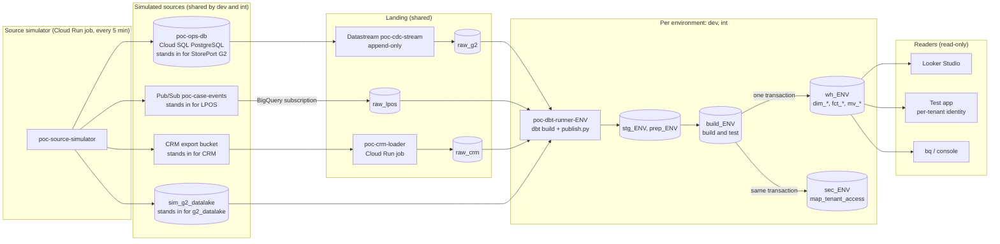

# POC 2: Store Alert Data Lake, Phase 2 (approved plan)

|                |                                                                                                                                            |
| -------------- | ------------------------------------------------------------------------------------------------------------------------------------------ |
| **Version**    | 2.0. Replaces the proposal in [GKS-POC-Phase2.md](GKS-POC-Phase2.md), which stays for reference                                           |
| **Story**      | _Build a centralized, read-only BigQuery data warehouse_                                                                                   |
| **Team**       | 5 developers. Developer 5 coordinates (kick-off, tracker, gates, contact with the PO)                                                      |
| **Length**     | 12 working days                                                                                                                            |
| **Sandbox**    | Project `data-lake-poc-512405`, region `us-central1`. Generated data only                                                                  |
| **Date**       | 2026-11-17                                                                                                                                 |

**How to read this plan**

- **Everyone:** read sections 0–4 (changes, scope, decisions, architecture), 12 (acceptance tests), 15 (gates) and
  17 (definition of done).
- **For your own work:** read the POC sections where you own tasks (5–11) and your column in section 14.2.
- **Task format:** every task has an ID (`A3`, `C7`), an owner, a day, what it needs first, and a "done when". A
  task is done when its "done when" holds, not when its pull request merges.
- **Code samples** are starting points. The names in them (datasets, jobs, tables) are the agreed names.
- **Task IDs** here are separate from the backlog IDs in the implementation guide (`A-01`, `B-03` and so on).

## Contents

0. [What changed from the proposal](#0-what-changed-from-the-proposal)
1. [In plain words](#1-in-plain-words)
2. [Scope boundary](#2-scope-boundary)
3. [Decisions D-20 to D-32](#3-decisions-d-20-to-d-32)
4. [Architecture and conventions](#4-architecture-and-conventions)
5. [Foundation (Days 1–2)](#5-foundation-days-12)
6. [POC A: Real-time path](#6-poc-a-real-time-path)
7. [POC B: One source of record for customers](#7-poc-b-one-source-of-record-for-customers)
8. [POC C: Transformation layer in dbt](#8-poc-c-transformation-layer-in-dbt)
9. [POC D: Tenant security and read-only access](#9-poc-d-tenant-security-and-read-only-access)
10. [POC E: Run like production](#10-poc-e-run-like-production)
11. [POC F: Performance and cost](#11-poc-f-performance-and-cost)
12. [Acceptance tests AT-15 to AT-37](#12-acceptance-tests-at-15-to-at-37)
13. [Data-quality checks DQ33 to DQ43](#13-data-quality-checks-dq33-to-dq43)
14. [Who does what](#14-who-does-what)
15. [Execution plan and gates](#15-execution-plan-and-gates)
16. [Budget and cost controls](#16-budget-and-cost-controls)
17. [Definition of done](#17-definition-of-done)
18. [If time runs short](#18-if-time-runs-short)
19. [Risks](#19-risks)
20. [Appendix A: POC 1 names to story names](#appendix-a-poc-1-names-to-story-names)
21. [Glossary](#glossary)

---

## 0. What changed from the proposal

| Area                                                                     | Proposal (v1)                                                     | This plan (v2)                                                                                                                                 | Review section |
| ------------------------------------------------------------------------ | ----------------------------------------------------------------- | ---------------------------------------------------------------------------------------------------------------------------------------------- | -------------- |
| Source data                                                              | Seeded once, then three scripted change batches                   | A **source simulator** keeps G2, LPOS, CRM and `sim_g2_datalake` changing all day. The three scripted batches stay for the repeatable tests     | 4.1            |
| `g2_datalake`                                                            | Not mentioned                                                     | `sim_g2_datalake`, read in place by dbt                                                                                                        | 4.2            |
| Tables                                                                   | 17 POC 1 tables under POC 1 names, plus account and market tables | POC 1 tables under the **story's names** (Appendix A), plus 7 story tables                                                                     | 4.3, 5.6       |
| Physical design                                                          | A learning outcome; one materialized view as a stretch goal       | Every fact partitioned and clustered; a partition filter required on every fact; two native materialized views                                 | 4.4            |
| Personal data                                                            | Masked in the marts                                               | **Tokens** in the warehouse. Policy tags and masking only on raw tables                                                                        | 4.5, 5.4       |
| Terraform                                                                | Implied                                                           | A stated deliverable: destroy and re-apply works without console steps                                                                         | 4.6            |
| Second environment                                                       | Stretch goal                                                      | Core (`int`)                                                                                                                                   | 4.7            |
| Dashboard                                                                | None                                                              | Looker Studio with viewer's credentials                                                                                                        | 4.8            |
| Audit                                                                    | None                                                              | Audit log sink; the security tests point to their log entries                                                                                  | 4.9            |
| Application identity                                                     | Stretch goal                                                      | Core: one service account per tenant, impersonated by the test application                                                                     | 4.10           |
| Tenant key                                                               | `ultimate_parent`                                                 | `tenant_id`, the CRM account id                                                                                                                | 5.5            |
| Market store list, store matching, `dim_store` split, "active buyer", Dataform | In scope                                                     | Cut                                                                                                                                            | 5.1–5.3, 5.9   |
| `entity_registry`                                                        | A separate deliverable                                            | A dbt seed that also holds the freshness promises                                                                                              | 5.8            |
| Publishing                                                               | "Swap in when everything passes"                                  | Build and test in `build_<env>`, then publish to `wh_<env>` in **one BigQuery transaction**                                                    | 6.2            |
| Row access policies                                                      | Written in Terraform                                              | Owned by the publish step, which also owns the published tables                                                                                | 6.3            |
| Lineage                                                                  | Column-level                                                      | Source to table                                                                                                                                | 6.1            |
| Access removal                                                           | "Immediately" in one place, "within one cycle" in another         | Within one cycle                                                                                                                               | 6.4            |
| Gate G6                                                                  | All 17 tables ported and proven equal                             | Alert tables and their dimensions. Marts move to Gate G7                                                                                       | 6.8            |
| Masking and token rules                                                  | Developer 2                                                       | Developer 5                                                                                                                                    | 6.9            |
| D-, AT- and DQ- references                                               | Referenced, not defined                                           | Defined here: decisions D-20 to D-32 (section 3), tests AT-15 to AT-37 (section 12), checks DQ33 to DQ43 (section 13)                          | 6.10           |
| Budget alert                                                             | 150 USD                                                           | 60 USD. Reservations exist only on the benchmark days                                                                                          | 6.5, 7         |

---

## 1. In plain words

### POC 1: a report card for every store (done)

The business needs one answer for each store: **"Is this store protected right now? If not, why, and who fixes
it?"** POC 1 answers it from batches of files.

1. **Collect.** A batch of files about stores, equipment, alerts and staff lands in a bucket. An untouched copy
   is kept.
2. **Check.** Every row is checked. Broken rows go to a "rejected" pile with the reason. Nothing is quietly thrown
   away.
3. **Organise.** Good rows go into linked tables: stores, devices, alert types, alerts and their history.
4. **Grade.** Each store gets a colour (🔴 not protected, 🟡 needs attention, 🟢 all good). With it come a
   plain-English reason, the next step, who owns the fix, how long the problem has lasted, and 30-day uptime.
5. **Report problems.** Missing information is reported as missing, never guessed.
6. **One pipeline.** A single workflow runs every step and logs each one.

**Its limits:**

- The answer is only as fresh as the last batch.
- Anyone with access could see every company's data if their query was careless.
- Cost and speed were never measured.
- It was set up with scripts and console steps, not Terraform.

### POC 2: live, private, trusted and affordable (this plan)

If POC 1 is a **printed report card**, POC 2 is a **live dashboard with locked doors and a price tag**.

**First, a source that never sleeps.** We don't have the client's systems, so we build stand-ins that behave like
them. A small operational database where alerts open and close every few minutes. A stream of loss-prevention
case events. An hourly CRM export. A stand-in for the client's existing data lake. Everything below has real,
changing data to react to.

Then six things:

- **A. Near-live updates.** We watch the source database directly. When an alert opens or closes, the change flows
  in, and the store's colour updates within about 15–20 minutes. Deleted records are marked "deleted" rather than
  vanishing. _Like going from a morning newspaper to live news._
- **B. One agreed definition of "customer".** The CRM is the only authority. Suppliers, partners and prospects
  never count as customers. Every customer company gets a stable id, which the locks in D use. _One official
  guest list instead of three._
- **C. A standard tool for the logic (dbt).** POC 1's logic is rebuilt in dbt, under the table names the story
  uses, with tests on every table. We prove the new version gives the same answers as POC 1. We also add some of
  the story's new tables: cases, cart wheels, work orders and a calendar. _From scribbled notes to a recipe book,
  with a taste test for each dish._
- **D. Locked doors between companies.** The database itself stops company A from seeing company B's rows,
  whoever asks: a person, the app or a dashboard. Readers can only read. No personal data reaches the warehouse at
  all: people appear only as anonymous tokens. _Everyone gets their own locked mailbox._
- **E. Run like a real production system.** It runs every 15 minutes. It never shows a half-finished result: new
  data is built and checked to the side, and published in one step only when everything passes. Each data type
  has a freshness promise, and a broken promise raises an alert. Code changes are checked before they go live, and
  the same code builds two environments. _A restaurant kitchen: food is tasted before it leaves._
- **F. Measure speed and cost.** We load about 50 million alert records, time the real questions under different
  set-ups, connect a dashboard, and work out the monthly cost of each pricing option. The figures come from our
  generated workload: they show _how_ to decide, not GKS's real bill. _A test drive with a fuel bill._

### Side by side

|                            | POC 1                      | POC 2                                                     |
| -------------------------- | -------------------------- | --------------------------------------------------------- |
| Data source                | Files, one batch at a time | Simulated database, event stream, CRM export and data lake, changing all day |
| How fresh                  | As fresh as the last batch | 15–20 minutes                                             |
| Who counts as a customer   | Not defined                | One rule, from the CRM                                    |
| Privacy between companies  | Depends on careful queries | Enforced by the database, for people, app and dashboard   |
| Personal data              | Names and emails in tables | Tokens only; raw personal data masked or blocked          |
| If a run fails             | Partly loaded tables       | Readers keep the last good version                        |
| Environments               | One, partly by hand        | Two, from the same Terraform and dbt code                 |
| Proof it's right           | Row rules                  | 23 acceptance tests, tests on every table, parity with POC 1 |
| Speed and cost             | Not measured               | Measured, with a monthly cost model                       |
| Length                     | 2 weeks                    | 12 working days                                           |

---

## 2. Scope boundary

The POC runs in our sandbox with generated data only. The story requirements below need client data or client
systems, so the POC builds a stand-in instead. **They are out of scope and don't count against the POC.**

| Story requirement                                                                    | Stand-in in the POC                                                                                         |
| ------------------------------------------------------------------------------------ | ----------------------------------------------------------------------------------------------------------- |
| Build on the existing `g2_datalake`, its scheduled queries and data-quality checks   | `sim_g2_datalake`, written by the simulator, with one scheduled query of its own (task A9)                  |
| Real schemas for StorePort G2, CRM and LPOS                                          | Generated schemas shaped like the story's entities (section 4.3)                                            |
| A model covering **all** StoreIQ API surfaces                                        | POC 1's tables under the story's names, plus 7 story tables (task C10)                                      |
| Benchmark with real `g2_bi_core` workloads                                           | The POC 1 reader questions plus the story's rollups (task F1)                                               |
| Cost analysis from current billing                                                   | A cost method applied to our generated workload (task F7)                                                   |
| Dev, Integration and Production in client projects; SOC 2 evidence                   | `dev` and `int` in our sandbox, from the same code (task E9)                                                |
| CRM host database and CRM change data capture                                        | An hourly CRM file export, loaded in batches (POC B)                                                        |
| Atlas crime data                                                                     | Skipped. The story hasn't defined its schema                                                                |

---

## 3. Decisions D-20 to D-32

**Status key:**

- **Approved:** a review recommendation the PO approved.
- **Confirm at G5:** a choice this plan makes where the review left an option open, or where the PO's answer to a
  review question isn't written down. Developer 5 confirms these with the PO by Gate G5 (task 0.1). If an answer differs,
  the tasks that depend on it are listed in the last column.

| #    | Decision                                                                                                                                                                     | Why                                                                                                                                                       | Status        | Affects             |
| ---- | ---------------------------------------------------------------------------------------------------------------------------------------------------------------------------- | --------------------------------------------------------------------------------------------------------------------------------------------------------- | ------------- | ------------------- |
| D-20 | The scope boundary in section 2                                                                                                                                              | No access to client data                                                                                                                                  | Approved      | All                 |
| D-21 | Every new dataset, the Datastream stream, the policy taxonomy and the reservations are in **`us-central1`**                                                                 | POC 1's `poc_dwh_dev` is there, and BigQuery only joins datasets in the same location. The POC 1 marts in `asia-south1` are copied over once (task 0.3)   | Confirm at G5 | All                 |
| D-22 | `dev` and `int` share the sandbox project. Sources and landing datasets are shared; everything dbt builds is per environment (section 4.2). `sim_g2_datalake` goes in a second project if we can create one | Two environments at no extra cost for sources                                                                                                             | Approved (4.7); layout: Confirm at G5 | 0.2, E9 |
| D-23 | The tenant is the **CRM account id**, carried as `tenant_id` on every tenant-scoped table. For accounts with a parent, the tenant is the top-level account                    | Stable id from the system of record                                                                                                                       | Approved      | B6, B7, D3, D4      |
| D-24 | A customer is an **active** CRM account whose type is **Customer**. One dbt macro, `is_customer()`, decides it; nothing else does                                            | One definition                                                                                                                                            | Approved      | B6, B8              |
| D-25 | Datastream writes **append-only** into `raw_g2`. dbt works out the current state: the latest change per key, with deletes kept as soft deletes                                 | Every change is kept, including deletes                                                                                                                   | Approved (v1) | A4, A10, A11        |
| D-26 | dbt runs as a Cloud Run job, started by Workflows. Cloud Scheduler starts the micro-batch every **15 minutes** in `dev` and **hourly** in `int`. A full rebuild runs daily | 15 minutes is the POC target, with the budget controls in section 16. Hourly meets the story's phase 1                                                    | Confirm at G5 | E3, E4              |
| D-27 | **Write-audit-publish.** dbt builds and tests in `build_<env>`. `publish.py` copies into `wh_<env>` in one multi-statement transaction. dbt never writes to `wh_<env>`     | Readers never see a half-finished build                                                                                                                   | Approved (6.2)| E5                  |
| D-28 | The **publish step owns everything in `wh_<env>`**: it creates the tables, the row access policies, the native materialized views and the table options                      | Published tables are never recreated, so their policies never disappear. One owner                                                                        | Confirm at G5 | E5, D4, C11         |
| D-29 | Personal data becomes **keyed-hash tokens** in dbt. The key is in Secret Manager and loaded into a dataset only the writer can read. Policy tags (and masking, if available) protect personal data in raw tables only | The story: no personal data in the consumable model                                                                                                       | Approved (4.5)| C9, D9              |
| D-30 | Tables use the **story's names**. POC 1 is ported through the mapping in Appendix A                                                                                          | The consumable model is the story's                                                                                                                       | Approved (5.6)| C2–C5               |
| D-31 | **Cut:** market store list, store matching, `dim_store` split, "active buyer", Dataform. `entity_registry` is a seed that holds the freshness promises                       | Not in the story                                                                                                                                          | Confirm at G5 | —                   |
| D-32 | **Parity baseline** is POC 1 as it exists in our repositories: the 9 `poc_dwh_dev` tables, rebuilt from one `clean` generator batch and frozen. POC 1 marts too, if the analytics service output can be copied; otherwise golden scenarios | We couldn't find the 17-table POC 1 the proposal describes                                                                                                 | Confirm at G5 | 0.3, C4, C6         |

---

## 4. Architecture and conventions

### 4.1 Data flow



Orchestration isn't drawn. Cloud Scheduler starts the simulator (every 5 minutes), the micro-batch workflow
(every 15 minutes in `dev`), the watchdog (every 5 minutes), the daily full load and the night-off and morning-on
workflows (section 10).

### 4.2 Datasets

All datasets are in `us-central1` (D-21). `{env}` is `dev` or `int`.

| Dataset                        | Scope                              | Written by                                        | Read by                                  | Contents                                                                                                                  |
| ------------------------------ | ---------------------------------- | ------------------------------------------------- | ---------------------------------------- | ------------------------------------------------------------------------------------------------------------------------- |
| `raw_g2`                       | Shared                             | Datastream                                        | dbt in both environments                 | One table per G2 table (`g2_<table>`), one row per change, with `datastream_metadata`                                     |
| `raw_g2_parity`                | Shared                             | Task A4, once                                     | Parity runs (C4)                         | Table snapshots of `raw_g2` taken right after the first full copy, before the simulator starts changing data              |
| `raw_lpos`                     | Shared                             | Pub/Sub BigQuery subscription                     | dbt                                      | `case_event`: one row per message                                                                                         |
| `raw_crm`                      | Shared                             | `poc-crm-loader`                                  | dbt                                      | `account_landing`, `store_landing`, `work_order_landing` (every export appended) and `load_log`. Contact columns are policy-tagged |
| `sim_g2_datalake`              | Shared; second project if possible | Simulator, and one scheduled query                | dbt                                      | `wheel`, `wheel_event`, `derived_alert`                                                                                   |
| `keys`                         | Shared                             | `scripts/security/load_token_key.py`, once        | `sa-dwh-writer-*` only                   | `token_key`: the key for personal-data tokens (C9)                                                                        |
| `stg_{env}`                    | Per environment                    | dbt                                               | dbt                                      | Views: rename, cast, deduplicate, current state per key                                                                   |
| `prep_{env}`                   | Per environment                    | dbt                                               | dbt                                      | Joins, tenant assignment, tokens, validation, the CRM replica                                                              |
| `build_{env}`                  | Per environment                    | dbt                                               | dbt tests, `publish.py`                  | The next version of every published table. The "write" and "audit" steps of write-audit-publish happen here               |
| `wh_{env}`                     | Per environment                    | `publish.py` only                                 | Readers                                  | Published `dim_*`, `fct_*`, `mv_*`. The only dataset tenants can read                                                     |
| `sec_{env}`                    | Per environment                    | `publish.py`                                      | Row access policies                      | `map_tenant_access` (principal to tenant)                                                                                 |
| `dq_{env}`                     | Per environment                    | dbt (`store_failures`)                            | Engineers                                | Failing rows per test; quarantined rows                                                                                   |
| `ops_{env}`                    | Per environment                    | Workflows, `publish.py`, tests, benchmark         | Engineers                                | Run log, publish log, freshness results, test and benchmark results                                                       |
| `scale`                        | Shared                             | Task F2                                           | Benchmark                                | 50-million-row copies. The micro-batch never reads it                                                                     |
| `audit_logs`                   | Shared                             | Log sink                                          | Engineers                                | BigQuery audit log entries                                                                                                |
| `poc1_baseline`                | Shared                             | Task 0.3, once                                    | Parity tests                             | The frozen POC 1 tables                                                                                                   |
| `dbt_<user>_*`, `dbt_pr_<n>_*` | Developer and CI                   | dbt on a laptop, and CI                           | The developer                            | Personal and pull-request builds. Pull-request datasets expire tables after one day                                       |

The POC 1 datasets (`poc_stage_dev`, `poc_dwh_dev`, `poc_ops_dev`, `poc_workflow`) are left alone after task 0.3.

### 4.3 Simulated sources

#### G2 database

- **Where:** Cloud SQL PostgreSQL `poc-ops-db`, database `g2`, schema `g2`.
- **Tables:** the 9 POC 1 stage tables, with the same columns, real types instead of text, a primary key and an
  `updated_at` column. The columns are in `packages/data_lake_schema/src/data_lake_schema/stage/tables/`.
- **Two new tables:** `store_access` and `heartbeat`.

| Table                                                                       | Key                               | Notes                                                                                               |
| --------------------------------------------------------------------------- | --------------------------------- | --------------------------------------------------------------------------------------------------- |
| `brands`, `teams`, `statuses`, `alert_types`, `stores`, `device_locations` | As in POC 1                       | Reference data. The simulator changes it rarely: a device moves store, a store closes               |
| `users`                                                                     | `user_id`                         | Holds personal data (`user_name`, `email`). Policy-tagged in `raw_g2` (task D9)                     |
| `alert_incidents`                                                           | `incident_id`                     | The simulator opens, updates and closes incidents, and now and then deletes one                     |
| `alert_history`                                                             | `history_id`                      | One row per status change or comment                                                                |
| `store_access`                                                              | (`principal`, `crm_account_id`)   | Who may see which CRM account. The source of `map_tenant_access`                                    |
| `heartbeat`                                                                 | `source`                          | The simulator updates its row every tick. The watchdog reads it (task E7)                           |

There are **no foreign keys**, so the simulator can plant an unknown device or store.

#### CRM export

- **Where:** `gs://data-lake-poc-512405-crm-exports/crm/export_ts=<yyyymmddThhmmss>/`.
- **When:** every hour, a full snapshot, written by the simulator.
- **Completeness:** `manifest.json` is written last, listing each file with its size and MD5. This is the POC 1
  upload pattern.

| File             | Key             | Columns                                                                                                                                         |
| ---------------- | --------------- | ----------------------------------------------------------------------------------------------------------------------------------------------- |
| `account.csv`    | `account_id`    | `account_id`, `account_name`, `customer_type_code`, `status` (Active, Inactive), `parent_account_id`, `primary_contact_name`, `primary_contact_email`, `updated_at`, `export_ts` |
| `store.csv`      | `crm_store_id`  | `crm_store_id`, `account_id`, `g2_store_id`, `status`, `updated_at`, `export_ts`                                                                |
| `work_order.csv` | `work_order_id` | `work_order_id`, `account_id`, `crm_store_id`, `g2_device_id`, `work_type`, `status`, `opened_at`, `closed_at`, `updated_at`, `export_ts`       |

- **Accounts:** one per `ultimate_parent` in the POC 1 data (the customers), plus about 10 vendors, partners and
  prospects.
- **Deletes:** accounts are never deleted in the CRM; they become Inactive.
- **Type codes:** CRM-style option-set codes, for example `100000000` Customer, `100000001` Vendor, `100000002`
  Partner, `100000003` Prospect. Developer 5 fixes the list in task 0.7.

#### LPOS case events

Pub/Sub topic `poc-case-events`, with Avro schema `poc-case-event` and JSON encoding.

| Field            | Type                 | Notes                                        |
| ---------------- | -------------------- | -------------------------------------------- |
| `event_id`       | string               | Unique per event. Duplicates are planted     |
| `case_id`        | string               |                                              |
| `event_type`     | string               | `CASE_OPENED`, `CASE_UPDATED`, `CASE_CLOSED` |
| `event_ts`       | long, timestamp-micros |                                            |
| `g2_store_id`    | string               |                                              |
| `offender_token` | string, nullable     | Already opaque. No names, no images          |
| `case_status`    | string               |                                              |
| `loss_amount`    | double, nullable     |                                              |
| `items_count`    | int, nullable        |                                              |

#### `sim_g2_datalake`

| Table           | Written by                                    | Contents                                                                                                                       |
| --------------- | --------------------------------------------- | ------------------------------------------------------------------------------------------------------------------------------ |
| `wheel`         | Simulator seed                                | One row per cart wheel: `wheel_id`, `g2_store_id`, `cart_id`, `installed_at`, `status`. About 20 wheels per active store       |
| `wheel_event`   | Simulator, every tick (load job, append)      | `event_id`, `wheel_id`, `event_type` (`LOCK`, `UNLOCK`, `EXIT_ATTEMPT`, `LOW_BATTERY`), `event_ts`. Partitioned on `DATE(event_ts)` |
| `derived_alert` | A scheduled query, hourly                     | A wheel with 3 or more `EXIT_ATTEMPT` events in an hour becomes an alert row. The same pattern as the story's `g2_datalake` derived alerts |

### 4.4 Identities

| Identity                                  | Used by                                     | Gets                                                                                                                                                                                                                   |
| ----------------------------------------- | ------------------------------------------- | ---------------------------------------------------------------------------------------------------------------------------------------------------------------------------------------------------------------------- |
| `sa-simulator`                            | Simulator job                               | Cloud SQL client; publisher on `poc-case-events`; object creator on the CRM bucket; editor on `sim_g2_datalake`                                                                                                        |
| `sa-crm-loader`                           | CRM loader job                              | Object viewer on the CRM bucket; editor on `raw_crm`; job user                                                                                                                                                         |
| `sa-dwh-writer-{env}`                     | dbt runner and `publish.py`                 | Viewer on `raw_*`, `sim_g2_datalake`, `keys`; editor on `stg`, `prep`, `build`, `sec`, `dq`, `ops` of its environment; editor on `wh_{env}` plus a custom role for row access policies; fine-grained reader on the personal-data tag; job user; the all-rows policy on every published table |
| `sa-orchestrator`                         | Workflows and Cloud Scheduler               | Invoker on the Cloud Run jobs; Workflows invoker; editor on `ops_{env}`; the Cloud SQL, Datastream and Scheduler rights the night-off workflow needs                                                                   |
| `sa-tenant-a-user`, `sa-tenant-b-user`    | Security tests; they stand for tenant staff | Viewer on `wh_{env}`; job user. Mapped to tenant A or B in `store_access`                                                                                                                                              |
| `sa-test-app`                             | Test application                            | Token creator on `sa-app-tenant-a` and `sa-app-tenant-b` only. Nothing in BigQuery                                                                                                                                     |
| `sa-app-tenant-a`, `sa-app-tenant-b`      | Impersonated by the test application        | Viewer on `wh_{env}`; job user. Mapped to one tenant each                                                                                                                                                              |
| Internal analyst (one team member)        | Internal view, tests                        | Viewer on `wh_{env}`; job user; the all-rows policy                                                                                                                                                                    |
| Two team members' Google accounts         | Looker Studio tenant check                  | Viewer on `wh_dev`; job user. Mapped to tenant A or B                                                                                                                                                                  |
| Cloud Build service account               | CI and CD                                   | Terraform plan and apply in the sandbox; editor on `dbt_pr_*`                                                                                                                                                          |

**No reader** has token creator or service account user on `sa-dwh-writer-{env}`. Test AT-27 checks this.

### 4.5 Repository layout

The platform repo (this one) gets these folders. Existing folders stay as they are.

```
platform-data-lake-poc/
├── terraform/
│   ├── modules/          cloudsql_g2, datastream_pg, pubsub_bq, crm_landing, sim_g2_datalake,
│   │                     service_accounts, bq_env, policy_tags, run_jobs, workflows,
│   │                     monitoring, reservations, audit_sink
│   ├── shared/           sources, landing datasets, simulator, loader, policy tags, audit sink,
│   │                     reservations (off by default)
│   └── env/              one root module for both environments
│       ├── main.tf
│       ├── dev.tfvars    dev.backend.hcl
│       └── int.tfvars    int.backend.hcl        <- the only files that differ between environments
├── dbt/
│   ├── dbt_project.yml  profiles.yml  packages.yml  Dockerfile  entrypoint.sh
│   ├── models/           sources/ staging/ intermediate/ marts/ rollups/ security/
│   ├── macros/  seeds/  tests/  analyses/
├── orchestration/
│   ├── micro_batch.workflow.yaml  full_load.workflow.yaml  watchdog.workflow.yaml
│   ├── night_off.workflow.yaml  morning_on.workflow.yaml
│   └── publish/          publish.py  tables.yaml  config.dev.yaml  config.int.yaml
│                         policies/*.sql  objects/*.sql  tests/
├── loaders/crm/          poc-crm-loader (Python, Dockerfile, tests)
├── apps/tenant_reader/   test application (Python command line)
├── sql/g2/               schema.sql  replication.sql
├── scripts/              g2_bootstrap.py  parity/  security/  scale/  benchmark/  acceptance/
├── cloudbuild/           pr.yaml  main.yaml   (existing files stay)
└── docs/poc2/            baseline.md  specs.md  spikes.md  cdc.md  parity.md  security-report.md
                          benchmark-results.md  cost-model.md  runbook.md
```

The simulator lives in `data-gen-upload-data-lake-poc`, in a new `simulator/` package with its own Dockerfile.
The existing upload function there doesn't change.

### 4.6 Conventions

- **Table names:** `dim_<entity>`, `fct_<process>`, and `mv_<rollup>` whatever its physical type. Staging models
  are `stg_<source>__<table>`; intermediate models are `int_<entity>__<verb>`.
- **Keys:** surrogate keys are `<entity>_key`; source ids stay as `<entity>_id`.
- **Tenant column:** every published table has `tenant_id`, except `dim_date`, `dim_alert_type` and the status
  lookup.
- **Lineage columns** on every published table: `_source_system`, `_source_updated_at`, `_dbt_loaded_at`,
  `_dbt_invocation_id`.
- **Labels** on every resource: `poc=phase2`, `env`, `owner=dev<n>`, `managed_by=terraform|dbt|publish`.
- **Branches and pull requests:** one per task, named `p2/<task-id>-<short-name>`. The title starts with the task
  ID. CI must pass. One reviewer from another POC.
- **dbt on a laptop:** use `--target local`. It builds into `dbt_<you>_*`, never into `build_dev` or `wh_dev`.
- **No console changes** to anything Terraform owns. If you click something to learn how it works, put it in
  Terraform the same day.
- **Secrets** live in Secret Manager. Never in code, `tfvars`, query text or logs.

---

## 5. Foundation (Days 1–2)

**Goal:** by the morning of Day 3, every developer can build without waiting for anyone else.

| ID   | Task                                                                                                                                               | Owner                      | Day | Needs          | Done when                                                                                                   |
| ---- | -------------------------------------------------------------------------------------------------------------------------------------------------- | -------------------------- | --- | -------------- | ----------------------------------------------------------------------------------------------------------- |
| 0.1  | Kick-off. Walk through this plan, confirm the decisions marked _Confirm at G5_, and create the tracker with every task ID                           | Dev 5, all                 | 1   | —              | Every task is in the tracker with its owner. Every open decision has an owner and a date                    |
| 0.2  | Terraform skeleton: state bucket (by hand, once), `terraform/shared`, `terraform/env` with `dev` and `int` variables, provider pins, labels        | Dev 4                      | 1–2 | —              | CI runs `terraform plan` for `shared`, `dev` and `int`                                                      |
| 0.3  | Freeze the POC 1 baseline                                                                                                                          | Dev 1                      | 1–2 | —              | `poc1_baseline` holds the 9 tables (and the marts, if available). `docs/poc2/baseline.md` lists row counts   |
| 0.4  | dbt skeleton                                                                                                                                       | Dev 1                      | 1–2 | —              | `dbt debug` and an empty `dbt build` pass on a laptop and in CI                                             |
| 0.5  | G2 schema: `sql/g2/schema.sql`                                                                                                                     | Dev 3 (Dev 2 reviews)      | 1   | —              | Applies cleanly to a local PostgreSQL 16                                                                    |
| 0.6  | Simulator, scripted mode, on a laptop                                                                                                              | Dev 3                      | 1–2 | 0.5            | `seed` and `batch --n 1..3` run against PostgreSQL in Docker; pytest is green                               |
| 0.7  | Specs: customer type codes, CRM export, case-event Avro schema, tenant model and test tenants, Appendix A mapping, personal-data inventory, store-health rules and golden scenarios | Dev 5 (Avro with Dev 4)    | 1–2 | —              | `docs/poc2/specs.md` reviewed by Dev 3 and Dev 4                                                            |
| 0.8  | Billing budget of 80 USD with alerts at 40, 60 and 80 USD, emailed to the team                                                                     | Dev 4                      | 1   | Billing access | A test alert email arrives                                                                                  |
| 0.9  | Spikes: six questions, half a day or less each (notes below)                                                                                       | Dev 2, Dev 1, Dev 4        | 2   | —              | `docs/poc2/spikes.md` answers each question with evidence                                                   |
| 0.10 | Cloud SQL Terraform module, ready to apply                                                                                                         | Dev 2                      | 1–2 | 0.2            | `terraform plan` shows `poc-ops-db` with the logical decoding flag                                          |
| G5   | **Gate G5**                                                                                                                                        | Dev 5, all                 | 2   | All above      | Section 15                                                                                                  |

### Task notes

**0.2 Terraform skeleton (Dev 4)**

1. By hand, once: create the state bucket `data-lake-poc-512405-tfstate` with versioning on. Write the command in
   `docs/poc2/runbook.md`.
2. `terraform/shared`: backend prefix `shared`. `terraform/env`: one root module, with
   `-backend-config=<env>.backend.hcl` and `-var-file=<env>.tfvars`.
3. Pin the `google` and `google-beta` providers to the current major version.
4. Add `default_labels` (`poc`, `env`, `managed_by`) in the provider block.
5. Turn on the APIs the plan needs with `google_project_service`: Cloud SQL Admin, Datastream, Pub/Sub, BigQuery,
   BigQuery Reservation, BigQuery Data Transfer, Data Catalog, BigQuery Data Policy, Workflows, Cloud Scheduler,
   Cloud Run, Secret Manager, Data Lineage, Cloud Build, Logging, Monitoring.
6. Resources POC 1 created by script stay unmanaged. Terraform only manages what Phase 2 adds.

**0.3 Freeze the POC 1 baseline (Dev 1)**

POC 1's data is generated and reproducible, so we rebuild it from one known batch.

1. Create `poc1_baseline` in `us-central1`.
2. Back up the current 9 tables:
   ```sql
   CREATE SNAPSHOT TABLE `data-lake-poc-512405.poc1_baseline.bak_dim_store`
   CLONE `data-lake-poc-512405.poc_dwh_dev.dim_store`;
   -- repeat for the other 8 tables
   ```
3. Empty the 9 `poc_dwh_dev` tables and load **one `clean` batch** with the POC 1 pipeline: the workflow, or the
   ETL job pointed at the batch folder.
4. Write down the batch folder name. Task A3 seeds Cloud SQL from the same batch, so both sides start from the
   same input.
5. Snapshot the 9 tables again, without the `bak_` prefix. This is the baseline.
6. **Marts:** if `store-alert-analytics` still runs, build its marts for this batch. Copy its `poc_analytics_dev`
   tables to `poc1_baseline`. They're in `asia-south1`, so use `bq extract` to a bucket, then `bq load` in
   `us-central1`. If the service is gone, write that down; mart parity then uses golden scenarios (C6).
7. Write `docs/poc2/baseline.md`: batch folder, date, row count per table.

**0.4 dbt skeleton (Dev 1)**

1. `dbt-core` and `dbt-bigquery` pinned in `dbt/requirements.txt`. Packages: `dbt_utils`, `dbt_expectations`.
2. Targets in `profiles.yml`:
   - `local`: your user (OAuth), dataset prefix `dbt_<you>`.
   - `ci`: dataset prefix `dbt_pr_<pull request number>`.
   - `dev`, `int`: the Cloud Run job's service account.
3. Dataset per layer:
   ```sql
   -- macros/generate_schema_name.sql
   
     
     
       {{ layer }}_{{ target.name }}          {# e.g. build_dev #}
     
       {{ target.schema }}_{{ layer }}        {# e.g. dbt_alice_build, dbt_pr_42_build #}
     
   
   ```
4. In `dbt_project.yml`:
   - `staging` models: `+schema: stg`, `+materialized: view`.
   - `intermediate` models: `+schema: prep`.
   - `marts` and `rollups`: `+schema: build`, `+contract: {enforced: true}`.
   - `security`: `+schema: build` (published to `sec_{env}` by `publish.py`).
   - Tests: `+store_failures: true`, `+schema: dq`.
5. Source datasets come from variables, so parity runs can point at the snapshot:
   `schema: "{{ var('g2_raw_dataset', 'raw_g2') }}"`.
6. See section 8 of the [implementation guide](bigquery-warehouse-implementation.md#8-workstream-c-dbt-transformation-layer)
   for packages, staging conventions and the validation-rule port. That guide puts each environment in its own
   project. Here both share one project, so add the `_{env}` suffix to its dataset names.

**0.5 G2 schema (Dev 3)**

- One `CREATE TABLE` per table in section 4.3. Columns and types come from the POC 1 stage models.
- Every table gets `updated_at TIMESTAMPTZ NOT NULL DEFAULT now()`. A trigger updates it on each `UPDATE`.
- Primary keys on every table. No foreign keys.

**0.6 Simulator, scripted mode (Dev 3)**

Command line, in `data-gen-upload-data-lake-poc/simulator/`:

```
python -m simulator seed --batch <folder from 0.3>   # schema check, reference data, POC 1 incidents and history
python -m simulator batch --n 1|2|3                  # scripted change batches; fixed random seed, same every run
python -m simulator tick                             # one continuous-mode tick (task A8)
python -m simulator crm-export [--big-change]        # one CRM export (task B2)
python -m simulator probe                            # latency probe (tests AT-16, AT-22)
python -m simulator revoke|grant --principal <email> --account <id>   # store_access changes (AT-25)
```

- **Configuration** comes from environment variables: `PG_INSTANCE` (or `PG_HOST` locally), `PG_DB`,
  `PG_SECRET`, `CASE_TOPIC`, `CRM_BUCKET`, `G2DL_PROJECT`, `RATE`.
- **The seed** builds its rows with the existing generator (`generate_synthetic_data.py`), so it is the same data
  POC 1 loaded.

The scripted batches:

| Batch | Changes                                                                                                                                                                                                  |
| ----- | -------------------------------------------------------------------------------------------------------------------------------------------------------------------------------------------------------- |
| 1     | Insert 20 incidents with 40 history rows. Update 10 open incidents to acknowledged                                                                                                                       |
| 2     | Close 15 incidents (set `resolved_at`, add history). Delete 3 incidents and their history. Move 1 device to another store                                                                                |
| 3     | Update 5 incidents twice each. Re-open 2 closed incidents. Plant 1 incident with a future time (DQ34), 1 with an unknown device (DQ33) and 1 resolved before it opened (DQ38)                            |

- After each batch, the simulator updates `heartbeat` with `source = 'batch-<n>'`. Tests wait for that row to
  reach `raw_g2`.
- The expected state after each batch goes in `simulator/expected/batch_<n>.json`: open, closed and deleted counts,
  and the planted rows. Tests AT-17 and AT-18 compare against it. This is the same idea as POC 1's expected-results
  files.

**0.7 Specs (Dev 5)** in `docs/poc2/specs.md`:

1. Customer type codes, with name, enum and whether the type counts as a customer.
2. CRM export columns and rules (section 4.3). Which stores belong to which account, and which 2 stores have no
   CRM record (DQ37).
3. Case-event Avro schema, with Dev 4.
4. Tenant model:
   - which accounts are test tenants A and B,
   - which principals map to them in `store_access`,
   - the internal identities.
5. Appendix A, column by column, so C2–C4 can follow it.
6. Personal-data inventory: every column in every source that identifies a person, and its policy tag.
7. Store-health rules, from `map_store_health_rule` in
   [Store_Alert_Warehouse_Schema_Suggestion_Update.html](../../data-lake-ETL-tool/docs/Store_Alert_Warehouse_Schema_Suggestion_Update.html).
   Add 5–8 **golden scenarios**: a store in a known state, with its expected colour and reason. Example: "S103,
   main door alarm open for 2 hours, is RED, with reason ...". Agree with Dev 3 which scripted batch creates each
   scenario.

**0.9 Spikes**

Use a scratch dataset `spike_<name>` and delete it afterwards.

| #   | Question                                                                                                                                                   | Owner | If the answer is "no"                                                                                     |
| --- | ---------------------------------------------------------------------------------------------------------------------------------------------------------- | ----- | --------------------------------------------------------------------------------------------------------- |
| 1   | Can a principal **without** read access to `map_tenant_access` query a table whose row policy has a subquery on it?                                        | Dev 2 | Give readers viewer on `sec_{env}`, and put a row policy on `map_tenant_access` itself: `principal = SESSION_USER()` |
| 2   | Can the writer, with an all-rows policy, run `DELETE` and `INSERT` in one transaction on a table with row policies and `require_partition_filter`?           | Dev 2 | Write down the exact error. The publish design (E5) changes before Day 6                                 |
| 3   | Is BigQuery data masking available to us with on-demand pricing?                                                                                          | Dev 2 | D9 uses column access control: readers without the tag get an error instead of a masked value           |
| 4   | Can we create a native materialized view on a table with row policies, or with `require_partition_filter`? What does a tenant see when querying it?          | Dev 1 | The native views are benchmarked for internal users only. Tenant-facing rollups stay dbt tables          |
| 5   | Does `CREATE TABLE ... LIKE` copy partitioning, clustering and `require_partition_filter`?                                                                  | Dev 1 | `publish.py` sets the missing options itself                                                              |
| 6   | One multi-statement transaction over about 20 tables: does it hit a limit, and how long does it take?                                                     | Dev 4 | Split into two transactions: dimensions with facts, then marts. Write down what readers may see between them |

---

## 6. POC A: Real-time path

**Goal:** changes in the simulated G2 database and case events flow into BigQuery all the time. The alert facts
stay current through incremental models, with soft deletes.

|                  |                                                                                                                                         |
| ---------------- | --------------------------------------------------------------------------------------------------------------------------------------- |
| **Owners**       | Dev 2 (Cloud SQL, Datastream), Dev 3 (simulator, change-data models), Dev 4 (Pub/Sub), Dev 1 (`sim_g2_datalake` dataset)                |
| **Needs**        | 0.2, 0.3, 0.5, 0.6, 0.7                                                                                                                 |
| **End state**    | The simulator changes every source every 5 minutes. `raw_g2` and `raw_lpos` follow within minutes. `fct_alert` and `fct_alert_history` are incremental, keep deletes, and equal a full rebuild |
| **Tests**        | AT-15, AT-16, AT-17, AT-18, AT-22, AT-23                                                                                                |
| **Learning**     | Change data capture, logical replication, append-only change logs, incremental merge, soft deletes, ordering of changes, streaming ingestion |

| ID  | Task                                                                                                                                                               | Owner                          | Day | Needs                | Done when                                                                                                       |
| --- | ------------------------------------------------------------------------------------------------------------------------------------------------------------------ | ------------------------------ | --- | -------------------- | --------------------------------------------------------------------------------------------------------------- |
| A1  | Cloud SQL `poc-ops-db` through Terraform                                                                                                                           | Dev 2                          | 3   | 0.10                 | Instance is up with logical decoding on. `datastream_user` can connect over SSL                                 |
| A2  | Replication bootstrap: schema, users, publication, slot (`scripts/g2_bootstrap.py` runs `sql/g2/*.sql`)                                                            | Dev 2                          | 3   | A1, 0.5              | `pg_replication_slots` shows `poc_slot`; the publication lists all 11 tables                                    |
| A3  | Seed `g2` from the baseline batch, plus the internal-only probe store `S-PROBE` with one device (used by AT-16)                                                    | Dev 3                          | 3   | A2, 0.3, 0.6         | Row counts equal the batch's accepted rows in `baseline.md`, plus the probe rows                                |
| A4  | Datastream stream `poc-cdc-stream` through Terraform: append-only into `raw_g2`, full backfill. Then snapshot `raw_g2` into `raw_g2_parity`                        | Dev 2                          | 3–4 | A2, A3               | Stream is running; backfill complete; snapshot taken; metadata fields recorded in `docs/poc2/cdc.md`            |
| A5  | AT-15 script: `scripts/acceptance/at15_cdc_initial.py`                                                                                                             | Dev 2                          | 5   | A4, A10              | AT-15 passes                                                                                                    |
| A6  | Case events through Terraform: Avro schema, topic, `raw_lpos.case_event`, BigQuery subscription, dead-letter topic and its pull subscription                       | Dev 4                          | 3–4 | 0.7                  | A test message lands in `raw_lpos.case_event`                                                                   |
| A7  | Simulator: case-event publisher, with planted duplicates                                                                                                           | Dev 3                          | 4–5 | A6                   | Events land; planted duplicates are visible in `raw_lpos`                                                       |
| A8  | Simulator in the cloud: image, Cloud Run job `poc-source-simulator`, Scheduler every 5 minutes, heartbeat, pause switch, rate setting                              | Dev 3 (code), Dev 4 (Terraform)| 5–6 | A3, A4 snapshot, A7  | The job runs every 5 minutes for 2 hours with no failures, and every source changes                             |
| A9  | `sim_g2_datalake`: project or dataset, `wheel`, `wheel_event`, the `derived_alert` scheduled query; simulator writer                                               | Dev 1 (BigQuery), Dev 3 (writer) | 5–6 | A8                 | dbt in `dev` reads it as a source. Derived alerts appear every hour                                             |
| A10 | Change-data staging: macro `cdc_current_state()` and one `stg_g2__<table>` view per table                                                                          | Dev 3                          | 3–4 | A4 (can start on a fixture table) | Each view has one row per key; deleted keys are flagged                                            |
| A11 | Incremental `fct_alert` and `fct_alert_history`: merge on the key, soft deletes, guard against older changes                                                       | Dev 3                          | 7–8 | C3, A10              | AT-18 passes                                                                                                    |
| A12 | Scripted-batch harness: run batches 1–3, build incrementally after each, compare with a full rebuild                                                               | Dev 3                          | 8–9 | A11                  | AT-17 passes                                                                                                    |
| A13 | _Stretch:_ Datastream private connectivity                                                                                                                         | Dev 2                          | —   | G7 passed            | The stream runs over private connectivity                                                                       |

### Task notes

**A1 Cloud SQL (Dev 2)**

- `google_sql_database_instance`, PostgreSQL 16.
- Smallest shared-core tier: `db-f1-micro`. Move to `db-g1-small` if it struggles.
- `database_flags { name = "cloudsql.logical_decoding"  value = "on" }`.
- Public IP, SSL required. Authorized networks: Datastream's static IPs for `us-central1` (shown when you create a
  connection profile with IP allowlisting).
- Backups off and `deletion_protection = false`: it's a sandbox.
- Night-off (E8) stops and starts the instance, so add
  `lifecycle { ignore_changes = [settings[0].activation_policy] }`.
- Passwords: `random_password`, stored in Secret Manager as `poc-ops-db-datastream` and `poc-ops-db-simulator`.

**A2 Replication bootstrap (Dev 2)**

```sql
-- sql/g2/replication.sql   (run as the postgres user, after schema.sql)
CREATE USER datastream_user WITH LOGIN PASSWORD :'ds_password';
ALTER USER datastream_user WITH REPLICATION;
GRANT USAGE ON SCHEMA g2 TO datastream_user;
GRANT SELECT ON ALL TABLES IN SCHEMA g2 TO datastream_user;
ALTER DEFAULT PRIVILEGES IN SCHEMA g2 GRANT SELECT ON TABLES TO datastream_user;

CREATE USER simulator_user WITH LOGIN PASSWORD :'sim_password';
GRANT USAGE ON SCHEMA g2 TO simulator_user;
GRANT SELECT, INSERT, UPDATE, DELETE ON ALL TABLES IN SCHEMA g2 TO simulator_user;

CREATE PUBLICATION poc_pub FOR TABLE
  g2.brands, g2.teams, g2.statuses, g2.users, g2.alert_types, g2.stores, g2.device_locations,
  g2.alert_incidents, g2.alert_history, g2.store_access, g2.heartbeat;
SELECT pg_create_logical_replication_slot('poc_slot', 'pgoutput');
```

> **Watch out: WAL retention.** If the stream is paused while the database runs, the slot keeps write-ahead log
> and the disk grows. The night-off order (E8) stops the database after pausing the stream. Never leave the stream
> paused with the simulator running for more than an hour.

**A4 Datastream (Dev 2)**

- Use the Terraform in section 7.1 of the
  [implementation guide](bigquery-warehouse-implementation.md#71-g2-and-atlas-postgresql-via-datastream-cdc),
  with these changes:
  - `append_only {}` instead of `merge {}`.
  - `single_target_dataset` is `raw_g2`.
  - Publication `poc_pub`, slot `poc_slot`.
  - A public-IP connection profile with SSL instead of private connectivity.
- Datastream names the tables `g2_<table>`, for example `raw_g2.g2_alert_incidents`.
- Grant the Datastream service agent editor on `raw_g2` only.
- When the backfill finishes, inspect the metadata:
  ```sql
  SELECT datastream_metadata.* FROM `raw_g2.g2_alert_incidents` LIMIT 20;
  ```
  Record in `docs/poc2/cdc.md` the field names and values for the change type, the source timestamp and the
  sequence number. Make an update and a delete by hand and record what they look like. The macro in A10 depends
  on this.
- Then snapshot every `raw_g2` table into `raw_g2_parity` (`CREATE SNAPSHOT TABLE ... CLONE ...`). The parity run
  (C4) reads this frozen copy, so the simulator can start straight after.

**A6 Case events (Dev 4)**

- `google_pubsub_schema` `poc-case-event`, type `AVRO`, definition from `terraform/shared/schemas/case_event.avsc`.
- `google_pubsub_topic` `poc-case-events` with `schema_settings { encoding = "JSON" }`.
- Table `raw_lpos.case_event`:
  - the Avro fields, plus `subscription_name`, `message_id`, `publish_time`, `attributes`;
  - partitioned on `publish_time` (day).
- Subscription `poc-case-events-to-bq`:
  - `bigquery_config { use_topic_schema = true, write_metadata = true }`;
  - `dead_letter_policy` to `poc-case-events-dlq`, `max_delivery_attempts = 5`.
- Add the pull subscription `poc-case-events-dlq-sub`, to inspect dead letters.
- IAM:
  - the Pub/Sub service agent needs editor on `raw_lpos`;
  - for dead-lettering, it also needs publisher on the dead-letter topic and subscriber on
    `poc-case-events-to-bq`.

**A8 Simulator in the cloud (Dev 3, Dev 4)**

Each continuous tick at `RATE=1.0`:

| Source            | Per tick                                                                                                                                       |
| ----------------- | ---------------------------------------------------------------------------------------------------------------------------------------------- |
| G2 incidents      | Open 3–6; update 3–6; close 2–5; add a history row for each one touched. Delete one about every 10 ticks. Move a device about every 50 ticks   |
| Case events       | Publish 1–5, never 0, so the watchdog always sees new events. About 2% are duplicates (same `event_id`); about 1% name an unknown store                                                        |
| Wheel events      | Append 50–200 rows to `sim_g2_datalake.wheel_event` with a load job (free), not streaming inserts. About 0.5% name an unknown wheel (DQ43)    |
| CRM               | On the first tick after each full hour, write an export (B2)                                                                                   |
| Planted defects   | About 0.5% of new incidents have an unknown device (DQ33) or a future time (DQ34)                                                              |
| Heartbeat         | Last step: `UPDATE g2.heartbeat SET beat_at = now() WHERE source = 'simulator'`                                                                |

- Connect with the Cloud SQL Python Connector; the password comes from Secret Manager.
- The image is built by the data-gen repo's Cloud Build and pushed to Artifact Registry.
- Terraform in `terraform/shared`:
  - `google_cloud_run_v2_job` `poc-source-simulator` with `MODE`, `RATE` and the source names as environment
    variables;
  - `google_cloud_scheduler_job` `poc-simulator-tick`, `*/5 * * * *`, calling the Cloud Run Admin API `:run`
    endpoint as `sa-orchestrator`.
- **Pause switch:** pause the scheduler job. **Rate:** a Terraform variable.

**A9 `sim_g2_datalake` (Dev 1, Dev 3)**

1. Create a second project (if you lack the rights, ask whoever administers the sandbox) (for example `data-lake-poc-src-<suffix>`) linked to the same
   billing account. If that isn't possible, use a dataset in the main project and note it in `spikes.md`. The
   cross-project read is then untested.
2. Create the dataset in `us-central1`, with the tables from section 4.3.
3. The `derived_alert` scheduled query:
   - `google_bigquery_data_transfer_config`, `data_source_id = "scheduled_query"`, every hour;
   - runs as a service account;
   - appends the last hour's derived alerts, using `@run_time`.
4. IAM: `sa-simulator` gets editor; `sa-dwh-writer-dev` and `sa-dwh-writer-int` get viewer.
5. dbt source: `database: <that project>`, `schema: sim_g2_datalake`.

**A10 Change-data staging (Dev 3)**

```sql
-- macros/cdc_current_state.sql
-- The newest full row per key, plus whether the newest change is a delete.
-- Field names and values: check them against docs/poc2/cdc.md (task A4).


with changes as (
  select
    t.* except (datastream_metadata),
    timestamp_millis(t.datastream_metadata.source_timestamp) as _source_updated_at,
    t.datastream_metadata.change_type = 'DELETE'             as _is_delete,
    t.datastream_metadata.change_sequence_number             as _seq
  from {{ source_relation }} as t
),
latest_change as (   -- the newest change of any kind
  select {{ keys }}, _is_delete as is_deleted, _source_updated_at
  from changes
  qualify row_number() over (partition by {{ keys }} order by _source_updated_at desc, _seq desc) = 1
),
latest_image as (    -- the newest full row; a DELETE row may carry only the key
  select * except (_is_delete, _source_updated_at, _seq)
  from changes
  where not _is_delete
  qualify row_number() over (partition by {{ keys }} order by _source_updated_at desc, _seq desc) = 1
)
select
  i.*,
  c.is_deleted,
  if(c.is_deleted, c._source_updated_at, null) as deleted_at,
  c._source_updated_at
from latest_change as c
join latest_image as i using ({{ keys }})

```

- **Updates:** if Datastream sends an update as a pair of rows (an "update-delete" and an "update-insert" with
  the same timestamp), sort so the insert half wins. Don't treat the delete half as a delete.
- **Why it's correct:** the view reads the whole change history each time, so the newest change wins however late
  it arrived. This is cheap at POC volume (a few thousand rows a day).

**A11 Incremental facts (Dev 3)**

Start from Dev 1's table version (C3) and make it incremental:

```sql
-- models/marts/fct_alert.sql
{{ config(
    materialized = 'incremental',
    incremental_strategy = 'merge',
    unique_key = 'incident_id',
    partition_by = {'field': 'alert_date', 'data_type': 'date'},
    cluster_by = ['tenant_id', 'store_id', 'device_id'],
    on_schema_change = 'append_new_columns'
) }}

with changes as (
  select * from {{ ref('int_alert__validated') }}
  
  where _source_updated_at >
        (select timestamp_sub(max(_source_updated_at), interval 30 minute) from {{ this }})
  
)

, newer_only as (   -- never replace a newer row with an older change
  select c.*
  from changes as c
  left join {{ this }} as t using (incident_id)
  where t.incident_id is null or c._source_updated_at >= t._source_updated_at
)
select * from newer_only

select * from changes

```

- **Don't** add `incremental_predicates` that limit the target by date. A late update to an old alert would then
  insert a duplicate instead of updating it.
- **Late changes:** a change that lands more than 30 minutes late can be missed until the daily full rebuild (E6).
  DQ39 counts any difference the full rebuild finds.

**A12 Scripted-batch harness (Dev 3)**

`scripts/acceptance/at17_incremental_vs_full.py`:

1. Pause `poc-simulator-tick`. Wait until no new changes arrive in `raw_g2` for 2 minutes.
2. For batch 1, 2 and 3:
   - run `simulator batch --n <n>`;
   - wait for `heartbeat` row `batch-<n>` to appear in `raw_g2`;
   - run `dbt build --target local --select +fct_alert +fct_alert_history`.
3. Build the same models with `--full-refresh` into a second personal dataset prefix.
4. Compare the two both ways (`EXCEPT DISTINCT`), leaving out `_dbt_loaded_at` and `_dbt_invocation_id`. Expect
   zero rows each way.
5. Compare the counts with `simulator/expected/batch_3.json`.
6. Run the incremental build again with no new changes. Row counts and a fingerprint of each table must not
   change. This is the "no duplicates on re-run" check.
7. Resume the simulator.

---

## 7. POC B: One source of record for customers

**Goal:** the CRM is the only definition of a customer. Every tenant has a stable `tenant_id`. Work orders arrive
from the CRM.

|               |                                                                                                                         |
| ------------- | ----------------------------------------------------------------------------------------------------------------------- |
| **Owners**    | Dev 5 (definitions, `dim_account`, tenant assignment), Dev 3 (export writer, loader, guard, watermark merge, work orders) |
| **Needs**     | 0.6, 0.7                                                                                                                |
| **End state** | Hourly CRM exports load by themselves. A change of more than half the rows is held. `dim_account` and `dim_store` carry `tenant_id` and the customer flag from one macro |
| **Tests**     | AT-19, AT-20, AT-21                                                                                                     |
| **Learning**  | Master data, watermark loads, change-size guards, one source of record per attribute                                    |
| **Cut**       | Market store list, `map_store_match`, `dim_store` split (D-31)                                                          |

| ID  | Task                                                                                                                                   | Owner | Day | Needs            | Done when                                                                                               |
| --- | -------------------------------------------------------------------------------------------------------------------------------------- | ----- | --- | ---------------- | ------------------------------------------------------------------------------------------------------- |
| B1  | CRM export spec and type codes (part of 0.7)                                                                                           | Dev 5 | 1–2 | —                | In `specs.md`                                                                                           |
| B2  | Simulator: CRM export writer. Hourly snapshot, manifest last, type and status changes, a planted unknown type code, `--big-change`     | Dev 3 | 3–4 | 0.6, B1          | An export folder appears every hour                                                                     |
| B3  | CRM loader `poc-crm-loader` (Cloud Run job): load new complete folders, safe to re-run, log each load                                  | Dev 3 | 4–5 | B2               | Running it twice loads nothing the second time                                                          |
| B4  | `stg_crm__*`, and the watermark merge `int_crm__account`, `int_crm__store`, `int_crm__work_order`                                      | Dev 3 | 5–6 | B3, 0.4          | AT-20 passes                                                                                            |
| B5  | Change-size guard in the loader (DQ42), with an approve command                                                                        | Dev 3 | 6–7 | B3               | AT-21 passes                                                                                            |
| B6  | `map_customer_type` seed, `is_customer()` macro, `dim_account`                                                                         | Dev 5 | 3–4 | B1 (B4 can be stubbed) | Tests pass. `dim_account` has `customer_type_enum`, `customer_type_name`, `is_customer` and `tenant_id` |
| B7  | Tenant assignment: `int_store__tenant` (G2 store to CRM store to account to top-level account); `tenant_id` and `is_customer_store` on `dim_store` | Dev 5 | 4–5 | B6, C2 | Every store has a tenant, or is listed by DQ37                                                          |
| B8  | AT-19 checks                                                                                                                           | Dev 5 | 5–6 | B6, B7           | AT-19 passes                                                                                            |
| B9  | `fct_work_order`                                                                                                                       | Dev 3 | 8   | B4               | Built and tested; partitioned on `opened_date`                                                          |
| B10 | _Stretch:_ history (type 2) on `dim_store` with a dbt snapshot                                                                         | Dev 5 | —   | G7 passed        | The snapshot shows a store moving account                                                               |

### Task notes

**B3 CRM loader (Dev 3)**

A Python Cloud Run job in `loaders/crm/`. The `dev` micro-batch starts it on every run; it costs almost nothing
when there's nothing new. The `int` micro-batch doesn't run it (variable `run_crm_loader = false`), because
`raw_crm` is shared.

1. List `crm/export_ts=*/manifest.json` in the bucket.
2. Skip folders that `raw_crm.load_log` already shows as `LOADED`.
3. **Stop at the first `HELD` folder.** Later exports wait behind it, so the watermark never jumps ahead.
4. For each new folder, oldest first:
   1. Check the manifest: every file present, with the right size and MD5. Reuse the check from
      `upload-file-validator-data-lake-poc`.
   2. Run the change-size guard (B5).
   3. Load each CSV into its `<entity>_landing` table with a load job: `WRITE_APPEND`, explicit schema,
      `skip_leading_rows=1`.
   4. If any file fails, delete that folder's rows from the landing tables (`WHERE export_ts = ...`) and mark the
      folder `FAILED`. The next run retries it.
   5. Write a `load_log` row: folder, files, rows, status, time.

**B4 Watermark merge (Dev 3)**

```sql
-- models/intermediate/crm/int_crm__account.sql
{{ config(materialized = 'incremental', incremental_strategy = 'merge', unique_key = 'account_id') }}

select *
from {{ ref('stg_crm__account') }}           -- typed; contact name and email already tokenised (C9)

where updated_at > (select max(updated_at) from {{ this }})     -- the watermark

qualify row_number() over (partition by account_id order by export_ts desc, updated_at desc) = 1
```

`stg_crm__account` replaces the contact name and email with `primary_contact_token` and drops the raw columns.
Personal data never goes past the staging view.

**B5 Change-size guard (Dev 3)**

- In the loader, before loading a folder, compare `account.csv` with the previous loaded export:
  - changed rows = rows whose (`account_id`, `updated_at`) pair is new, plus accounts that disappeared;
  - ratio = changed rows ÷ rows in the previous export.
- If the ratio is above 0.5:
  - mark the folder `HELD` and load nothing;
  - log a structured `ERROR` with `event = "crm_guard_tripped"`. An alert policy (E7) emails the team.
- **Release:** a person checks the export, then runs the job once with `--approve export_ts=<...>`.
- Unit tests cover:
  - 0% change;
  - 49% change;
  - 51% change;
  - the first export ever, with nothing to compare against: load it.

**B6 Customer definition (Dev 5)**

`seeds/map_customer_type.csv`:

```csv
customer_type_code,customer_type_enum,customer_type_name,counts_as_customer
100000000,CUSTOMER,Customer,true
100000001,VENDOR,Vendor,false
100000002,PARTNER,Partner,false
100000003,PROSPECT,Prospect,false
```

```sql
-- macros/is_customer.sql   (the only place that decides who is a customer)

  ({{ type_enum_col }} = 'CUSTOMER' and {{ status_col }} = 'Active')

```

- Columns of `dim_account`:
  - `account_key`, `account_id`, `tenant_id` (the top-level account, D-23), `account_name`;
  - `customer_type_code`, `customer_type_enum`, `customer_type_name`;
  - `is_customer`, `status`, `parent_account_id`, `primary_contact_token`;
  - the lineage columns.
- **Unknown codes** get the enum `UNKNOWN` and `is_customer = false`, and appear in DQ36.

**B7 Tenant assignment (Dev 5)**

- **Path:** G2 store, to the active CRM store record with the same `g2_store_id`, to its account, to the
  top-level account. That account's id is the store's `tenant_id`.
- **Stores with no CRM record:** `tenant_id` is null and `is_customer_store = false`. They appear in DQ37 as a
  warning. Only internal users can see them, because a null tenant matches no tenant policy.
- **Stores of a non-customer account** (a vendor, say) have `is_customer_store = false`. No tenant principal maps
  to such an account (B8), so no tenant sees them.

**B8 AT-19 checks (Dev 5)**

1. **Test:** every `dim_account` row with `is_customer = true` has enum `CUSTOMER` and status `Active`.
2. **Test:** every tenant in `map_tenant_access` is a customer account.
3. **CI script** `scripts/ci/check_single_definition.py`: the literal `'CUSTOMER'` and the code `100000000` appear
   only in the seed and the macro.
4. **Planted data:** a vendor account linked to two stores. Those stores have `is_customer_store = false`, and the
   security suite (D5) shows no tenant can see them.

---

## 8. POC C: Transformation layer in dbt

**Goal:** POC 1 rebuilt in dbt under the story's names, proven equal to the baseline, plus the story tables. Every
model is tested, and every fact is partitioned and clustered.

|               |                                                                                                              |
| ------------- | ------------------------------------------------------------------------------------------------------------ |
| **Owners**    | Dev 1 (lead: port, parity, tests, physical design), Dev 5 (definitions, tokens, rules), with models from Dev 3 and Dev 4 |
| **Needs**     | 0.3, 0.4, 0.7, A10                                                                                           |
| **End state** | Every published table is a dbt model with tests. Parity with POC 1 is shown. The story tables exist. Facts are partitioned with a required filter and clustered. Two native materialized views exist |
| **Tests**     | AT-26, AT-33, AT-34                                                                                          |
| **Learning**  | dbt models, incremental materialisation, tests as contracts, reusable business logic, documentation and lineage |
| **Cut**       | "Active buyer", Dataform (D-31)                                                                              |

| ID  | Task                                                                                                                                                                                                   | Owner                      | Day | Needs              | Done when                                                                                  |
| --- | ------------------------------------------------------------------------------------------------------------------------------------------------------------------------------------------------------ | -------------------------- | --- | ------------------ | ------------------------------------------------------------------------------------------ |
| C1  | Conventions: folder layout, a `schema.yml` template, and a CI check that every `build` model has `unique` and `not_null` tests on its key and a description on every column                            | Dev 1                      | 3   | 0.4                | The CI check fails a pull request that breaks the rule                                     |
| C2  | Port the dimensions: `dim_store` (brand folded in, tenant from B7), `dim_device`, `dim_alert_type`. Seeds: `status`, `map_store_health_rule`                                                            | Dev 1                      | 3–4 | A10                | Built and tested in `dbt_<you>_build`                                                      |
| C3  | Port the facts, as plain tables first: `fct_alert` (with `assignee_token`, `assignee_team_name`) and `fct_alert_history`                                                                               | Dev 1                      | 4–5 | C2, C9 macro       | Built and tested                                                                           |
| C4  | Parity for the alert tables and dimensions (AT-26a), in `scripts/parity/`                                                                                                                             | Dev 1                      | 6   | C3, 0.3, A4        | AT-26a passes; `docs/poc2/parity.md` explains every difference                             |
| C5  | Port the marts: `mv_store_health`, `mv_incident_health`, `mv_current_issues`, `mv_downtime_interval`, `mv_alert_trend_daily`, `mv_alert_trend_weekly`                                                 | Dev 1 (models), Dev 5 (rules) | 7–8 | C3, 0.7         | Built and tested                                                                           |
| C6  | Mart parity, or the golden scenarios if the POC 1 marts weren't available (AT-26b). Confirms POC 1 health results are unchanged for customer stores                                                    | Dev 5                      | 9–10 | C5                 | AT-26b passes                                                                              |
| C7  | Port the POC 1 validation rules as tests with a severity. Critical rules quarantine rows; warnings flag them. Add DQ33–DQ43 (section 13)                                                              | Dev 1 (framework); each check's owner | 7–9 | C1        | Every planted defect is caught by its check                                                |
| C8  | Shared definitions as macros: `is_customer()` (B6) and `is_open_alert()`. Every model uses them                                                                                                       | Dev 5                      | 4–6 | —                  | The single-definition CI check (B8) covers both                                            |
| C9  | Tokens: `tokenize()` macro, the key table, and the personal-data test (DQ41)                                                                                                                          | Dev 5                      | 4–6 | —                  | No `build` column holds a name or an email; DQ41 fails a planted column                     |
| C10 | Story tables (AT-33): `dim_date` (Dev 5); `dim_wheel`, `fct_wheel_event`, `mv_cart_count_daily` (Dev 1); `fct_case`, `dim_offender` (Dev 4); `fct_work_order` (Dev 3, task B9)                      | As listed                  | 7–8 | A6, A9, B4         | Built and tested; benchmark query 8 runs on `fct_case`                                     |
| C11 | Physical design (AT-34): partitioning and clustering on every fact; `tables.yaml` entries for publishing; the two native materialized views in `orchestration/publish/objects/`                        | Dev 1                      | 8–9 | E5                 | AT-34 passes                                                                               |
| C12 | Source freshness in `sources.yml`, with the values from the entity registry (E7)                                                                                                                      | Dev 4                      | 7   | E7                 | `dbt source freshness` passes for every source                                             |

### Task notes

**C2, C3 Porting (Dev 1)**

- **What to read:**
  - [transforms.py](../../data-lake-ETL-tool/app/warehouse_load/transforms.py) is the spec for the joins and
    derived columns.
  - [warehouse-dataset-plan.md](../../data-lake-ETL-tool/docs/warehouse-dataset-plan.md) and the models in
    `packages/data_lake_schema/src/data_lake_schema/dwh/tables/` give the target columns.
  - Appendix A and `specs.md` give the renames.
- **People:** `dim_user` and `dim_team` aren't ported. `fct_alert` carries `assignee_token` (the user, tokenised)
  and `assignee_team_name`. A team name isn't personal data.
- **Contracts:** model contracts are on for `build` models (0.4). A column type can't change without someone
  noticing, and `publish.py` relies on stable columns.
- **Order:** C3 builds the facts as plain tables first, so parity can be shown on Day 6. A11 makes them
  incremental on Days 7–8. Re-run C4 after A11.

**C4 Parity (Dev 1)**

1. Build from the frozen copy, into your personal datasets:
   ```
   dbt build --target local --vars '{g2_raw_dataset: raw_g2_parity}' --select +fct_alert +fct_alert_history +dim_store +dim_device +dim_alert_type
   ```
2. For each POC 1 table, compare the mapped columns both ways. Example:
   ```sql
   -- scripts/parity/fct_alert.sql
   with poc1 as (
     select incident_id, alert_id, store_id, device_id, alert_type_id, created_at, resolved_at, priority
     from `data-lake-poc-512405.poc1_baseline.fct_alert_incident`
   ),
   p2 as (
     select incident_id, alert_id, store_id, device_id, alert_type_id, opened_at as created_at, resolved_at, priority
     from `data-lake-poc-512405.dbt_<you>_build.fct_alert`
     where not is_deleted
   )
   select 'only_in_poc1' as side, * from (select * from poc1 except distinct select * from p2)
   union all
   select 'only_in_poc2' as side, * from (select * from p2 except distinct select * from poc1)
   ```
   Take the column names from the POC 1 models and `specs.md`. The ones above are examples.
3. **Users:** the number of distinct `assignee_token` values equals the number of distinct assigned users in POC 1.
4. **Brands:** `dim_store` joined to the POC 1 `dim_brand` gives the same brand columns.
5. **Expected result:** zero rows each way. Explain any other result, row by row, in `docs/poc2/parity.md`.
   `tenant_id` and the lineage columns are new, so they aren't compared.

**C5, C6 Marts and golden scenarios (Dev 1, Dev 5)**

- The POC 1 marts came from `store-alert-analytics`, which isn't in our repositories. The rules come from
  `map_store_health_rule` in the schema suggestion document. Dev 5 turns them into the seed in 0.7.
- `mv_store_health` stays a dbt table: its rule logic is beyond what a native materialized view supports. The
  other marts are dbt tables too, except `mv_alert_trend_daily` in `wh` (C11).
- **If task 0.3 copied the POC 1 marts:** compare as in C4.
- **Golden scenarios:** in all cases, `seeds/golden_store_health.csv` holds the expected colour and reason for each
  scenario store. A singular test compares `mv_store_health` with it after the scripted batch that creates each
  state.

**C7 Validation rules (Dev 1)**

- **Spec:** [validation-rules.md](../../data-lake-ETL-tool/docs/validation-rules.md). The method is in section 8.6
  of the [implementation guide](bigquery-warehouse-implementation.md#86-porting-the-poc-validation-rules).
- **Rules that no longer apply:** with a typed source database, the type and format rules (`BAD_TYPE`,
  `BAD_PATTERN`) are enforced by PostgreSQL. Mark them "enforced at source" in the rule list rather than dropping
  them silently.
- **Quarantine:** `int_alert__validated` adds `_dq_status` and `_dq_reasons`. Facts keep rows where `_dq_status`
  isn't `QUARANTINE`. The model `dq_{env}.quarantine_alert` holds the rest.

**C9 Tokens (Dev 5)**

- **Where the key lives:** in table `keys.token_key`, readable only by `sa-dwh-writer-dev` and `sa-dwh-writer-int`.
  It's loaded once by `scripts/security/load_token_key.py` from Secret Manager.
- **Why not an environment variable:** the script uses a **load job**, not a query. The implementation guide's
  environment-variable method puts the key in the compiled SQL, and from there into the job history, where many
  people can read it.

```sql
-- macros/tokenize.sql

  to_hex(sha256(concat(
    (select key from `{{ target.project }}.keys.token_key`), '|', cast({{ expr }} as string)
  )))

```

- **DQ41** runs on every build: a singular test over `build_{env}.INFORMATION_SCHEMA.COLUMNS` fails if a column
  name is on the deny list (`email`, `phone`, `first_name`, `last_name`, `user_name`, `contact_name`). Names like
  `store_name` are on an allow list.
- **The daily full load** also scans every `STRING` column in `build` for email-like values.
- **Test the test:** in a pull request, add a model with an `email` column and check that CI fails.

**C10 Story tables**

| Table                 | Owner | Grain and source                                                                                                                | Notes                                                                                                                         |
| --------------------- | ----- | ------------------------------------------------------------------------------------------------------------------------------- | ----------------------------------------------------------------------------------------------------------------------------- |
| `dim_date`            | Dev 5 | One row per day, 2024-01-01 to 2027-12-31, from `dbt_utils.date_spine`                                                         | Tag `daily`                                                                                                                   |
| `fct_case`            | Dev 4 | One row per case, the latest event. From `stg_lpos__case_event`, deduplicated on `event_id`                                    | Incremental merge on `case_id`. Partitioned on `case_date`. `tenant_id` from the store                                        |
| `dim_offender`        | Dev 4 | One row per (`tenant_id`, `offender_token`): first seen, last seen, case count                                                 | Per tenant, so one tenant can't learn that a token exists at another                                                          |
| `dim_wheel`           | Dev 1 | One row per wheel, from `sim_g2_datalake.wheel`                                                                                 | `tenant_id` from the store                                                                                                    |
| `fct_wheel_event`     | Dev 1 | One row per wheel event, from `sim_g2_datalake.wheel_event`, deduplicated on `event_id`                                       | Incremental. Partitioned on `event_date`; clustered on `tenant_id`, `store_id`, `wheel_id`                                    |
| `fct_work_order`      | Dev 3 | One row per work order, from `int_crm__work_order`                                                                              | Partitioned on `opened_date`; clustered on `tenant_id`, `store_id`, `device_id`                                                |
| `mv_cart_count_daily` | Dev 1 | Per tenant, store and day: event count, exit attempts, active wheels                                                            | A native materialized view in `wh` (C11). A dbt version stays in `build` for comparison                                       |

**C11 Physical design (Dev 1)**

1. **Every fact** has a `partition_by` on its date and `cluster_by = ['tenant_id', 'store_id', <device or wheel>]`.
   In `build`, facts don't require a partition filter; that would get in the way of dbt tests. In `wh`, they do:
   `publish.py` sets it.
2. **`tables.yaml`** tells `publish.py` how to publish each table:
   ```yaml
   tables:
     - {name: fct_alert,         kind: fact, partition_column: alert_date, tenant_scoped: true}
     - {name: fct_alert_history, kind: fact, partition_column: event_date, tenant_scoped: true}
     - {name: dim_store,         kind: dim,  tenant_scoped: true}
     - {name: dim_alert_type,    kind: dim,  tenant_scoped: false}
     - {name: map_tenant_access, kind: dim,  tenant_scoped: false, dataset: sec}
     # ... one line per published table
   objects:                      # created by publish.py if missing
     - objects/mv_cart_count_daily.sql
     - objects/mv_alert_trend_daily.sql
   ```
3. **The two native materialized views**, partitioned like their base tables, so republishing a partition only
   refreshes that partition:
   ```sql
   -- orchestration/publish/objects/mv_cart_count_daily.sql
   CREATE MATERIALIZED VIEW IF NOT EXISTS `{project}.wh_{env}.mv_cart_count_daily`
   PARTITION BY event_date
   CLUSTER BY tenant_id, store_id
   AS
   SELECT tenant_id, store_id, event_date,
          COUNT(*)                          AS event_count,
          COUNTIF(event_type = 'EXIT_ATTEMPT') AS exit_attempts,
          APPROX_COUNT_DISTINCT(wheel_id)   AS active_wheels   -- COUNT(DISTINCT) isn't allowed here
   FROM `{project}.wh_{env}.fct_wheel_event`
   GROUP BY tenant_id, store_id, event_date;
   ```
   `mv_alert_trend_daily` does the same on `fct_alert`. It replaces the dbt mart of that name in `wh`; the dbt
   version stays in `build` for parity.
4. **If spike 4 said no:** create the two views in `build_{env}` and benchmark them for internal users only. Keep
   the dbt tables in `wh`. Write down why.

---

## 9. POC D: Tenant security and read-only access

**Goal:** BigQuery itself keeps each tenant to its own rows, for people, the application and the dashboard.
Readers can't write. No personal data reaches the warehouse; personal data in raw tables is masked or blocked.

|               |                                                                                                                       |
| ------------- | --------------------------------------------------------------------------------------------------------------------- |
| **Owners**    | Dev 2 (lead: identities, policies, tests, audit, application identity), Dev 5 (tenant rules, policy tags, masking)    |
| **Needs**     | 0.9 spikes 1–3, B6, E5                                                                                                |
| **End state** | Every tenant-scoped table in `wh` has two row policies. The security suite proves isolation and read-only access for every identity, with audit log evidence |
| **Tests**     | AT-24, AT-25, AT-27, AT-28                                                                                            |
| **Learning**  | Row-level security, column-level security and masking, least-privilege IAM, negative testing                          |

| ID  | Task                                                                                                                                                                                       | Owner                 | Day | Needs          | Done when                                                                                       |
| --- | ------------------------------------------------------------------------------------------------------------------------------------------------------------------------------------------ | --------------------- | --- | -------------- | ----------------------------------------------------------------------------------------------- |
| D1  | Spikes 1–3 (task 0.9)                                                                                                                                                                      | Dev 2                 | 2   | —              | Answers in `spikes.md`                                                                          |
| D2  | Identities and IAM in Terraform (section 4.4), including the writer's custom role                                                                                                          | Dev 2                 | 3–4 | 0.2            | Applied. The access matrix is in `docs/poc2/security-report.md`                                 |
| D3  | `store_access` rows for the test principals (simulator seed), and the `map_tenant_access` model                                                                                            | Dev 5 (rules), Dev 2 (model) | 6–7 | A4, B6  | One row per (principal, tenant); customer tenants only                                          |
| D4  | Row policy SQL in `orchestration/publish/policies/`. Apply it to `wh_dev` by hand until E5 applies it on every publish                                                                     | Dev 2                 | 7   | D3, 0.9        | Both policies on every tenant-scoped `wh_dev` table                                             |
| D5  | Security suite: `scripts/security/test_access.py` (pytest)                                                                                                                                 | Dev 2                 | 7–8 | D4             | AT-24 (command-line part) and AT-27 pass                                                        |
| D6  | Access-removal test                                                                                                                                                                        | Dev 2                 | 8–9 | D5, E4         | AT-25 passes                                                                                    |
| D7  | Test application `apps/tenant_reader` with per-tenant impersonation                                                                                                                        | Dev 2                 | 8–9 | D2, D4         | AT-24 (application part) passes                                                                 |
| D8  | Audit log sink to `audit_logs`, and the evidence queries in the security report                                                                                                            | Dev 2                 | 9–10 | D5             | The report links each blocked attempt to its log entry                                          |
| D9  | Policy taxonomy and tags on raw personal data (`raw_crm` contact columns; `raw_g2.g2_users` name and email); masking if available                                                          | Dev 5 (Dev 2 reviews) | 7–8 | 0.9, A4, B3    | AT-28 passes                                                                                    |
| D10 | Looker Studio tenant check, with F5                                                                                                                                                        | Dev 5, Dev 2          | 11  | F5             | AT-24 (dashboard part) passes                                                                   |

### Task notes

**D2 Identities (Dev 2)**

- **Service accounts** as in section 4.4, in `modules/service_accounts`.
- **Custom role `pocDwhWriterRls`** for `sa-dwh-writer-{env}`, with these permissions:
  - `bigquery.rowAccessPolicies.create`, `.update`, `.delete`, `.list`, `.getIamPolicy`, `.setIamPolicy`;
  - `bigquery.tables.setCategory`.
- **Readers get no project-level BigQuery data roles.** Only job user at project level, plus viewer on their
  datasets.

**D3 `map_tenant_access` (Dev 2, Dev 5)**

```sql
-- models/security/map_tenant_access.sql   (built in build_{env}, published to sec_{env})
select distinct
  a.principal,          -- a plain email: what SESSION_USER() returns
  t.tenant_id
from {{ ref('stg_g2__store_access') }} as a
join {{ ref('dim_account') }}          as t on t.account_id = a.crm_account_id
where not a.is_deleted
  and t.is_customer
```

**D4 Row access policies (Dev 2)**

`publish.py` fills in `{project}`, `{env}`, `{table}` and the grantee lists from `config.<env>.yaml`.

```sql
-- orchestration/publish/policies/all_rows.sql
CREATE ROW ACCESS POLICY IF NOT EXISTS rls_all_rows
ON `{project}.wh_{env}.{table}`
GRANT TO ({all_rows_principals})        -- the writer, the internal analyst
FILTER USING (TRUE);

-- orchestration/publish/policies/tenant.sql
CREATE ROW ACCESS POLICY IF NOT EXISTS rls_tenant
ON `{project}.wh_{env}.{table}`
GRANT TO ({tenant_principals})          -- every tenant user and per-tenant app identity
FILTER USING (tenant_id IN (
  SELECT tenant_id
  FROM `{project}.sec_{env}.map_tenant_access`
  WHERE principal = SESSION_USER()
));
```

Things that will bite:

- **A principal named in no policy sees zero rows.** The writer must be in `rls_all_rows`, or its own reads
  return nothing.
- **Grantee lists:** `IF NOT EXISTS` doesn't change an existing policy.
  - `publish.py` keeps a hash of each policy's SQL in `ops_{env}.publish_policy_state`.
  - When the SQL changes (for example, a new tenant principal), it runs `CREATE OR REPLACE` instead.
  - If the team can create a Google group for tenant readers, grant to the group, and the list rarely changes.
- **Tables without `tenant_id`** (`dim_date`, `dim_alert_type`) get no policies. Every reader can read them.

**D5 Security suite (Dev 2)**

- **How it runs:** pytest, impersonating each identity with `google.auth.impersonated_credentials`. Whoever runs
  it (CI, or a developer) needs token creator on the test service accounts, and **not** on the writer.
- **Results** go to `ops_{env}.security_test_result` and the security report.

| #   | Case                                                                                                       | Expected                                                    |
| --- | ---------------------------------------------------------------------------------------------------------- | ----------------------------------------------------------- |
| 1   | Each tenant identity: per tenant-scoped table, total rows and rows with another tenant's id                | Total equals the internal count for that tenant; others = 0 |
| 2   | Each reader: `INSERT`, `UPDATE`, `DELETE`, `MERGE`, `CREATE TABLE`, `DROP TABLE`, `ALTER TABLE` in `wh`     | Access denied                                               |
| 3   | Each reader: `SELECT` from `raw_*`, `stg`, `prep`, `build`, `dq`, `ops`, `keys`                            | Access denied                                               |
| 4   | Each reader: impersonate `sa-dwh-writer-{env}`                                                             | Permission denied                                           |
| 5   | Internal analyst without the personal-data tag: `SELECT primary_contact_email FROM raw_crm.account_landing` | Masked value, or denied (spike 3)                           |
| 6   | Stores with a null tenant, and stores of a vendor account, as a tenant                                     | Not visible                                                 |
| 7   | Tenant identity during a publish (E5)                                                                      | Sees the old version, then the new one. Never a mix         |

**D6 Access removal (Dev 2)**

1. As tenant A's user, count tenant A rows in `wh_dev.fct_alert`.
2. Run `simulator revoke --principal <tenant A user> --account <tenant A>` and note the time.
3. Poll as tenant A's user every minute until the count is 0. Pass if this takes no more than one cycle
   (20 minutes).
4. Run `simulator grant ...` to restore access, and check the rows come back.

**D7 Test application (Dev 2)**

- `python -m tenant_reader --tenant A --query store_health` runs as `sa-test-app`.
- It looks up the tenant's service account in its configuration, impersonates it, and runs a parameterised query
  with `maximum_bytes_billed`.
- **Negative cases:**
  - acting for tenant A, a query filtered on tenant B's id returns 0 rows;
  - impersonating `sa-dwh-writer-dev` is refused.

**D8 Audit logs (Dev 2)**

- BigQuery's data access audit logs are on by default.
- `google_logging_project_sink` `poc-bq-audit`:
  - filter `protoPayload.serviceName="bigquery.googleapis.com"`;
  - writes to dataset `audit_logs` with partitioned tables;
  - its writer identity needs editor on that dataset.
- The security report shows each blocked attempt from D5 twice: its log entry, and its job in
  `INFORMATION_SCHEMA.JOBS_BY_PROJECT` with `error_result.reason = 'accessDenied'`.

**D9 Personal data in raw tables (Dev 5)**

1. **Taxonomy** `poc-pii` in `us-central1`, with tag `pii_direct` (names and emails). Fine-grained reader goes to
   `sa-dwh-writer-dev`, `sa-dwh-writer-int` (they tokenise) and one internal person (for the test).
2. **Tagging raw tables:**
   - `raw_crm` landing tables: Terraform owns their schema, so set `policyTags` there.
   - `raw_g2.g2_users`: Datastream creates this table, so `scripts/security/tag_raw_columns.py` adds the tags
     through the tables API. Re-run it if the table is ever recreated.
3. **Masking:** if spike 3 said yes, create a data policy on `pii_direct` with a SHA-256 or default masking rule,
   and grant masked reader to the internal analyst. If not, readers without the tag get an error. That still
   meets the story.
4. **After tagging,** check that Datastream still writes to `g2_users` (the stream shows no errors) and that the
   loader still loads. If either fails, grant its identity fine-grained reader on the tag.

---

## 10. POC E: Run like production

**Goal:** the pipeline runs by itself every 15 minutes, never publishes half-built data, keeps its freshness
promises, deploys only through CI, and builds two environments from the same code.

|               |                                                                                                                                                  |
| ------------- | ------------------------------------------------------------------------------------------------------------------------------------------------ |
| **Owners**    | Dev 4 (lead), Dev 2 (night-off and morning-on)                                                                                                   |
| **Needs**     | 0.2, 0.4, A8, B3                                                                                                                                 |
| **End state** | `dev` publishes every 15 minutes and `int` every hour, from the same commit. A failed build publishes nothing. A stale source raises an alert within 15 minutes |
| **Tests**     | AT-29, AT-31, AT-32, AT-35, AT-36, AT-37                                                                                                         |
| **Learning**  | Micro-batch orchestration, atomic publishing, freshness contracts, lineage, CI/CD for data, environment promotion                                |

| ID  | Task                                                                                                                                         | Owner         | Day | Needs          | Done when                                                                                       |
| --- | -------------------------------------------------------------------------------------------------------------------------------------------- | ------------- | --- | -------------- | ----------------------------------------------------------------------------------------------- |
| E1  | CI on pull requests: `cloudbuild/pr.yaml`                                                                                                    | Dev 4         | 3–5 | 0.2, 0.4       | AT-36 passes                                                                                    |
| E2  | CD on merge: `cloudbuild/main.yaml`. Applies `shared` and `dev` (and `int` from Day 9); builds and pushes the dbt runner and loader images  | Dev 4         | 6   | E1             | A merge deploys with no manual step                                                             |
| E3  | dbt runner image and Cloud Run job `poc-dbt-runner-{env}`                                                                                    | Dev 4         | 5–6 | 0.4            | The job runs `dbt build` in the cloud                                                           |
| E4  | Micro-batch workflow `poc-micro-batch-{env}`, and its scheduler                                                                              | Dev 4         | 7–8 | E3, B3         | Runs every 15 minutes for a day; every run is logged                                            |
| E5  | `publish.py`: write-audit-publish                                                                                                            | Dev 4         | 7–8 | E3, 0.9        | AT-29 passes                                                                                    |
| E6  | Daily full load `poc-full-load-{env}`, with the drift check (DQ39)                                                                           | Dev 4         | 9   | E5             | Runs nightly; drift is recorded                                                                 |
| E7  | Freshness: `entity_registry` seed, `freshness_check`, watchdog workflow, alert policies, email channel                                       | Dev 4         | 7–9 | E4, A8         | AT-32 passes                                                                                    |
| E8  | Night-off and morning-on workflows                                                                                                           | Dev 2 (Dev 4 reviews) | 5–6 | A1, A4, A8 | Each run by hand once by Day 6, with no errors and no data lost; then scheduled               |
| E9  | Second environment, `int`                                                                                                                    | Dev 4         | 9–10 | E2–E5          | AT-31 passes                                                                                    |
| E10 | Lineage on, and dbt docs published                                                                                                           | Dev 4         | 10  | E2             | AT-37 passes                                                                                    |
| E11 | Forced-failure test                                                                                                                          | Dev 4         | 9   | E5             | AT-29 passes                                                                                    |
| E12 | Terraform destroy and re-apply test                                                                                                          | Dev 4, Dev 2  | 11  | Everything in Terraform | AT-35 passes                                                                           |
| E13 | Runbook `docs/poc2/runbook.md`: pause and resume, approve a held CRM export, re-run, reservations, teardown                                  | Dev 4         | 11–12 | —             | Another developer follows it without help                                                       |

### Task notes

**E1 CI on pull requests (Dev 4)**

Cloud Build trigger on pull requests to `main`. Make it a required check in GitHub branch protection.

1. **Terraform:** `fmt -check -recursive`, then `validate` and `plan` for `shared`, `dev` and `int`. Print a
   one-line summary of each plan.
2. **Python:** pytest for `loaders/`, `orchestration/publish/`, `apps/` and `scripts/`.
3. **dbt:**
   - create the `dbt_pr_<number>_*` datasets with a one-day default table expiration;
   - run `dbt deps`, then `dbt build --target ci`.
   - The sources are the shared landing datasets, read-only.
4. **Checks:**
   - key tests and descriptions on every model (C1);
   - one definition of customer (B8);
   - the only files that differ between environments are `*.tfvars` and `*.backend.hcl`.

**E3 dbt runner (Dev 4)**

- **Image:** `python:3.12-slim` with the pinned dbt packages. It copies in `dbt/` and `orchestration/publish/`,
  and runs `dbt deps` at build time.
- **`entrypoint.sh` commands:**
  - `microbatch`: `dbt build --exclude tag:daily`, then `publish.py` only if dbt exited 0.
  - `fullload`: the full load (E6).
  - `dbt <args>`: pass-through.
- **Why build and publish share one execution:** publish only ever sees the build it follows.
- **The job:** runs as `sa-dwh-writer-{env}`, with `DBT_TARGET={env}`. Timeout 15 minutes, no retries; the
  workflow decides.
- **Artifacts:** `run_results.json` and `manifest.json` go to `gs://data-lake-poc-512405-dbt-artifacts/<env>/<run_id>/`.

**E4 Micro-batch workflow (Dev 4)**

Reuse the `log_step` pattern and the error handling from
[workflow.yaml](../../workflow-data-lake-poc/workflow.yaml).

```yaml
# orchestration/micro_batch.workflow.yaml   (outline)
main:
  params: [args]
  steps:
    - init:          # run_id, env, project; run_crm_loader from the workflow's variables
    - single_run:    # if another execution of this workflow is ACTIVE: log SKIPPED and return
    - load_crm:      # if run_crm_loader: googleapis.run.v2.projects.locations.jobs.run on poc-crm-loader, and wait
    - freshness_src: # dbt job, args [dbt, source, freshness, --target, env]; warn only
    - build_publish: # dbt job, args [microbatch]; fails the workflow if dbt or publish fails
    - freshness:     # dbt job, args [dbt, run-operation, freshness_check, --target, env]
    - log:           # log_step into ops_{env}.pipeline_run_steps after every step, with status and error
```

- **Schedule:** `*/15 * * * *` in `dev`; `0 * * * *` in `int`.
- **Run time:** keep a run under 4 minutes, or the 20-minute promise breaks. If it grows, tag the alert-path
  models `hot` and run only `tag:hot` every 15 minutes, with everything else hourly.

**E5 `publish.py` (Dev 4)**

| Step | What it does                                                                                                                                                                                         |
| ---- | ---------------------------------------------------------------------------------------------------------------------------------------------------------------------------------------------------- |
| 1    | If dbt didn't exit 0: log `PUBLISH_SKIPPED` and stop. `wh_{env}` is untouched                                                                                                                         |
| 2    | For each fact in `tables.yaml`: find the partitions this run changed. `SELECT DISTINCT <partition_column> FROM build_{env}.<fact> WHERE _dbt_invocation_id = @invocation_id`                         |
| 3    | **Set-up, outside the transaction** (these are DDL, which a transaction can't hold). All idempotent: <br>• `CREATE TABLE IF NOT EXISTS wh.<t> LIKE build.<t>`<br>• `require_partition_filter` on facts<br>• `ADD COLUMN` for new columns. A removed or retyped column stops the publish with a clear message: that needs a planned migration<br>• Row policies (D4)<br>• Native materialized views (C11) |
| 4    | **One transaction** (below)                                                                                                                                                                          |
| 5    | **Checks:** <br>• Row counts in `wh` equal `build` for dimensions and marts, and for the changed fact partitions<br>• Both policies exist on every tenant-scoped table (`rowAccessPolicies.list`)<br>A failed check fails the job, so the alert fires |

```sql
-- generated by publish.py; column lists are explicit, taken from INFORMATION_SCHEMA.COLUMNS
BEGIN
  BEGIN TRANSACTION;

  -- dimensions, marts and map_tenant_access: replace everything
  DELETE FROM `wh_dev.dim_store` WHERE TRUE;
  INSERT INTO `wh_dev.dim_store` (<columns>) SELECT <columns> FROM `build_dev.dim_store`;

  -- facts: only the partitions this run changed
  DELETE FROM `wh_dev.fct_alert` WHERE alert_date IN UNNEST(@fct_alert_dates);
  INSERT INTO `wh_dev.fct_alert` (<columns>)
    SELECT <columns> FROM `build_dev.fct_alert` WHERE alert_date IN UNNEST(@fct_alert_dates);

  -- ... every table in tables.yaml ...

  INSERT INTO `ops_dev.publish_log` (run_id, invocation_id, published_at, tables)
  VALUES (@run_id, @invocation_id, CURRENT_TIMESTAMP(), @table_list);

  COMMIT TRANSACTION;
EXCEPTION WHEN ERROR THEN
  ROLLBACK TRANSACTION;
  RAISE USING MESSAGE = @@error.message;
END;
```

- Readers see either the old version of every table or the new one, never a mix.
- Published tables are never recreated, so their row policies stay in place.

**E6 Daily full load (Dev 4)**

- **When:** at 20:15 in the team's time zone, Monday to Friday, after the night-off pauses the micro-batch. It
  reads only BigQuery, so it doesn't need Cloud SQL running.
- **Steps:**
  1. Clone every incremental fact: `CREATE OR REPLACE TABLE ops_{env}.prev_<fact> CLONE build_{env}.<fact>`.
  2. Run `dbt build --full-refresh`.
  3. **DQ39:** compare each fact with its clone, both ways. Write the count of differing rows to
     `ops_{env}.dq_result`. Any difference is an error to explain; it means the incremental logic missed
     something.
  4. Publish every partition: `publish.py --all`.
  5. Scan `build` for personal data (C9).

**E7 Freshness (Dev 4)**

The entity registry is a dbt seed. It is the list of entities and the freshness promise of each.

| entity          | source_system | measured_on                | ts_column            | sync_mode | promise (minutes) | checked by      | owner |
| --------------- | ------------- | -------------------------- | -------------------- | --------- | ----------------- | --------------- | ----- |
| `alert`         | g2            | `wh.fct_alert`             | `_source_updated_at` | cdc       | 20                | micro-batch     | Dev 3 |
| `alert_history` | g2            | `wh.fct_alert_history`     | `_source_updated_at` | cdc       | 20                | micro-batch     | Dev 3 |
| `case_raw`      | lpos          | `raw_lpos.case_event`      | `publish_time`       | stream    | 5                 | micro-batch     | Dev 4 |
| `case`          | lpos          | `wh.fct_case`              | `_source_updated_at` | stream    | 20                | micro-batch     | Dev 4 |
| `crm_export`    | crm           | `raw_crm.account_landing`  | `export_ts`          | batch     | 75                | micro-batch     | Dev 3 |
| `wheel_event`   | g2_datalake   | `wh.fct_wheel_event`       | `_source_updated_at` | batch     | 30                | micro-batch     | Dev 1 |
| `heartbeat`     | g2            | `raw_g2.g2_heartbeat`      | source timestamp     | cdc       | 8                 | watchdog        | Dev 4 |

- **Why measure where we do:** most entities are measured on the published table, because that is what readers
  see. The CRM is measured on its landing table, because unchanged accounts keep old timestamps. The heartbeat
  covers the simulator, Cloud SQL and Datastream together.
- **`freshness_check`:** a run-operation macro.
  - For each entity, it measures now minus the newest `ts_column` in `measured_on`.
  - It writes a row to `ops_{env}.freshness_result`.
  - For each breach, it prints a JSON log line with `severity: ERROR` and `event: freshness_breach`.
- **Watchdog** `poc-watchdog`: a workflow every 5 minutes. It runs one cheap query: the age of the newest
  `simulator` heartbeat in `raw_g2.g2_heartbeat`, and of the newest `raw_lpos.case_event` row (filtered to the
  last day). If either is **older than 8 minutes**, it logs `event: watchdog_stale` at `ERROR`. Threshold 8 plus
  interval 5 keeps detection inside the 15-minute promise.
- **Alert policies** in `modules/monitoring`, each emailing the team:
  1. failed executions of any `poc-*` workflow;
  2. a log-based metric on `freshness_breach`;
  3. a log-based metric on `watchdog_stale`;
  4. a log-based metric on `crm_guard_tripped` (B5).

**E8 Night-off and morning-on (Dev 2, Dev 4 reviews)**

| Workflow         | Schedule                                     | Steps, in this order                                                                                                                                                                  |
| ---------------- | -------------------------------------------- | ------------------------------------------------------------------------------------------------------------------------------------------------------------------------------------- |
| `poc-night-off`  | 20:00, Monday to Friday, team's time zone    | 1. Pause the scheduler jobs: simulator, micro-batch `dev` and `int`, watchdog<br>2. Pause the Datastream stream<br>3. Stop Cloud SQL (`activationPolicy = NEVER`)                      |
| `poc-morning-on` | 08:00, Monday to Friday                      | 1. Start Cloud SQL (`ALWAYS`) and wait until it's runnable<br>2. Resume the stream<br>3. Resume the simulator<br>4. Wait 5 minutes, then resume the micro-batch and watchdog jobs, so the first freshness check sees new data |

- Terraform ignores the drift these workflows cause: `ignore_changes` on the stream's `desired_state`, the
  scheduler jobs' `paused`, and the instance's activation policy.
- **The 24-hour run** (AT-32) needs one night with night-off switched off. Start it on the afternoon of Day 9, so it finishes before Gate G7 on Day 10.

**E9 Second environment (Dev 4)**

1. `terraform apply -var-file=int.tfvars` with `int.backend.hcl`, from CD, on the same commit as `dev`.
2. This creates the `*_int` datasets, `sa-dwh-writer-int`, the `int` jobs, workflows and schedulers (hourly), and
   the monitoring.
3. dbt target `int`; `publish/config.int.yaml`.
4. **AT-31:**
   - the diff between environments is `*.tfvars` and `*.backend.hcl` only;
   - a micro-batch run in `int` is green;
   - the security suite's tenant cases pass in `int`.

**E10 Lineage and docs (Dev 4)**

- **Lineage:** turn on the Data Lineage API in Terraform. BigQuery jobs then record lineage by themselves.
  - Check that the lineage view for `wh_dev.fct_alert` shows `raw_g2` to `build_dev` to `wh_dev`.
  - Lineage is between tables, not columns (review 6.1).
- **dbt docs:** CD runs `dbt docs generate --static`, which writes one self-contained HTML file, and copies it to
  `gs://data-lake-poc-512405-dbt-docs/<env>/index.html`. The team opens it through the authenticated Cloud Storage
  link.

**E11 Forced failure (Dev 4)**

1. Record a fingerprint of every `wh_dev` table:
   `SELECT BIT_XOR(FARM_FINGERPRINT(TO_JSON_STRING(t))) FROM wh_dev.<table> AS t`, with a partition filter
   that covers every date on facts.
2. Run the micro-batch with `--vars '{force_fail: true}'`. A singular test on `mv_store_health` fails when this
   variable is set. That model sits in the middle of the graph, so some `build` tables have already changed when
   it fails.
3. **Pass when:**
   - the workflow fails and the alert email arrives;
   - every `wh_dev` fingerprint is unchanged;
   - both policies are still on every tenant-scoped table.
4. Run a normal micro-batch. It publishes.

**E12 Terraform rebuild (Dev 4, Dev 2)**

1. `terraform destroy` the `int` environment, then `apply` it again from CI.
2. Run one `int` micro-batch and the security suite's tenant cases. Pass if both are green with no console step.
3. For `shared`, `terraform plan` must show no changes: everything that exists is in code.
4. The one-time steps go in the runbook:
   - state bucket;
   - `g2_bootstrap.py`;
   - `load_token_key.py`;
   - the second project;
   - Looker Studio.

---

## 11. POC F: Performance and cost

**Goal:** measure how fast the real questions are at scale, under each pricing set-up, with and without security,
and work out the monthly cost and the break-even point. The figures come from generated workload.

|               |                                                                                                                       |
| ------------- | --------------------------------------------------------------------------------------------------------------------- |
| **Owners**    | Dev 1 (scale data, runner, reservations, cost model), Dev 5 (questions, Looker Studio, report)                        |
| **Needs**     | C10, C11, D4                                                                                                          |
| **End state** | `benchmark-results.md` and `cost-model.md` are written. A Looker Studio report shows different rows to two tenants. Reservations are destroyed |
| **Tests**     | AT-24 (dashboard), AT-30, AT-34                                                                                       |
| **Learning**  | Query plans, partitioning and clustering at scale, BI Engine, slot and byte costs, pricing models                     |

| ID  | Task                                                                                                                                                                                     | Owner                 | Day  | Needs       | Done when                                                                 |
| --- | ---------------------------------------------------------------------------------------------------------------------------------------------------------------------------------------- | --------------------- | ---- | ----------- | ------------------------------------------------------------------------- |
| F1  | Benchmark questions as parameterised SQL in `scripts/benchmark/queries/`, with expected answers on `dev` data                                                                            | Dev 5                 | 7–8  | C5, C10     | 10 queries reviewed by Dev 1                                              |
| F2  | Scale data: `scripts/scale/build_scale.sql` fills the `scale` dataset                                                                                                                    | Dev 1                 | 10–11 | C11         | `scale.fct_alert_history` has about 50 million rows; policies in place    |
| F3  | Benchmark runner `scripts/benchmark/run.py`, writing to `ops_dev.benchmark_result`                                                                                                        | Dev 1                 | 8–10 | F1          | A dry run of 2 queries × 2 runs works                                     |
| F4  | Reservations in Terraform, behind two flags that default to `false`: `enable_bi_engine` (a 10 GB BI Engine reservation) and `enable_enterprise_reservation` (autoscaling 0 to 100 slots, with a project assignment) | Dev 1 (Dev 4 reviews) | 9–10 | 0.2 | `plan` with a flag on shows its reservation; with both off it shows nothing |
| F5  | Looker Studio report on `wh_dev`, with viewer's credentials                                                                                                                              | Dev 5                 | 11   | D4          | Two tenant users see different rows in the same report                    |
| F6  | Benchmark runs (schedule below). Reservations destroyed by Day 12 noon                                                                                                                   | Dev 1, Dev 5          | 11–12 | F2–F4       | Every cell of the matrix has results                                      |
| F7  | Cost model `docs/poc2/cost-model.md`                                                                                                                                                     | Dev 1                 | 12   | F6          | AT-30 passes (cost part)                                                  |
| F8  | Benchmark report `docs/poc2/benchmark-results.md`                                                                                                                                        | Dev 1, Dev 5          | 12   | F6          | AT-30 passes (benchmark part)                                             |
| F9  | _Stretch:_ Power BI Desktop in DirectQuery mode                                                                                                                                          | Dev 5                 | —    | G8 on track | One report works                                                          |

### Task notes

**F1 Questions (Dev 5)**

| #     | Question                                                                                     | Reads                                                     |
| ----- | -------------------------------------------------------------------------------------------- | --------------------------------------------------------- |
| q1–q6 | The six POC 1 reader questions (Dev 5 lists them from the POC 1 documents)                   | `mv_store_health`, `fct_alert`, `fct_alert_history`       |
| q7    | Store coverage by brand and region: customer stores against stores without a customer account | `dim_store`, `dim_account` (internal identity only)       |
| q8    | Current cases by store                                                                       | `fct_case`                                                |
| q9    | Cart exit attempts by store and day, last 30 days: native view, dbt table and base fact      | `mv_cart_count_daily`, `fct_wheel_event`                  |
| q10   | Daily alert trend, last 90 days: native view, dbt table and base fact                        | `mv_alert_trend_daily`, `fct_alert`                       |

Every query on a fact has a date filter, as a dashboard would.

**F2 Scale data (Dev 1)**

- **How:** generate in BigQuery, not in Python. Multiply the `wh_dev` rows across about 3 years and 200 tenants.
- **Shape:** the tables keep the same schema, partitioning and clustering as `wh`.
- **Security:** `scale.map_tenant_access` maps the test identities to a few of the 200 tenants, and the same
  policies are applied.
- **Rollups:** the script builds both the native view and the table version of each.

```sql
CREATE OR REPLACE TABLE `scale.fct_alert_history`
PARTITION BY event_date
CLUSTER BY tenant_id, store_id, device_id
AS
SELECT
  CONCAT(h.history_id, '-', CAST(m AS STRING))                                       AS history_id,
  CONCAT('T', CAST(MOD(ABS(FARM_FINGERPRINT(CONCAT(h.store_id, CAST(m AS STRING)))), 200) AS STRING)) AS tenant_id,
  DATE_SUB(h.event_date, INTERVAL MOD(m, 1095) DAY)                                  AS event_date,
  h.* EXCEPT (history_id, tenant_id, event_date)
FROM `wh_dev.fct_alert_history` AS h
CROSS JOIN UNNEST(GENERATE_ARRAY(1, @multiplier)) AS m
WHERE h.event_date >= '2000-01-01';     -- the partition filter wh requires
```

Choose `@multiplier` so the table reaches about 50 million rows. Check the size with a dry run first.

**F3 Runner (Dev 1)**

- **Each query runs 10 times per cell**, with `use_query_cache = false` and `maximum_bytes_billed = 2 GB`.
  - Run 1 is "cold": the first run after a set-up change.
  - Runs 2–10 are "warm".
- **Recorded from `INFORMATION_SCHEMA.JOBS_BY_PROJECT`:** duration, `total_bytes_billed`, `total_slot_ms`, and
  `bi_engine_statistics` (mode and reasons).
- **Output:** 50th and 95th percentile per query and cell.

**F6 Schedule and matrix**

| When          | Set-up                                          | Identities                       |
| ------------- | ----------------------------------------------- | -------------------------------- |
| Day 11 morning  | On-demand                                                              | Internal (all rows), tenant A           |
| Day 11 noon     | Apply with `enable_bi_engine=true`                                     | —                                       |
| Day 11 afternoon| On-demand with BI Engine; Looker Studio check (F5, D10)                | Internal, tenant A, Looker Studio users |
| Day 11 evening  | Apply with `enable_bi_engine=false`. **BI Engine destroyed**           | —                                       |
| Day 12 morning  | Apply with `enable_enterprise_reservation=true`; Enterprise runs       | Internal, tenant A                      |
| Day 12 noon     | Apply with `enable_enterprise_reservation=false`. **Reservation destroyed.** Check both in the console | — |

- Security on and off is measured by identity: the internal identity passes through the all-rows policy; tenant A
  passes through the tenant policy.
- **While the Enterprise reservation is assigned,** every query in the project uses it, the micro-batch included.
  That's fine for half a day.

**F5 Looker Studio (Dev 5)**

- **Data sources:** BigQuery tables `wh_dev.mv_store_health` and `wh_dev.fct_alert`.
- **Credentials:** set "Data credentials" to **Viewer**, so each viewer's own identity runs the queries and the
  row policies apply.
- **Partition filter:** for `fct_alert`, tick "use `alert_date` as date range dimension". Every chart then sends a
  partition filter.
- **Sharing:** share with the two tenant users and the internal analyst. Screenshots of each go into the security
  report (D10).

**F7 Cost model (Dev 1)**

1. **Measured workload** from `region-us-central1.INFORMATION_SCHEMA.JOBS_BY_PROJECT`:
   - one normal day of micro-batch runs (Day 9);
   - the benchmark queries.
2. **Three scenarios per month:**
   - S1: the POC workload, running all the time, plus 20 dashboard users × 50 queries a day;
   - S2: S1 with 10 times the data;
   - S3: S1 with 100 times the data.
3. **Prices:** from the BigQuery pricing page on the day, with the date written down. Never in code:
   - on-demand per TiB;
   - Enterprise per slot-hour;
   - BI Engine per GiB-hour;
   - storage.
4. **On-demand cost** = TiB billed × price, after the free monthly allowance.
5. **Editions cost** = slot-hours × price. Slot-hours = `SUM(total_slot_ms) / 3.6e6`, plus an allowance for
   autoscaling steps and the one-minute minimum, plus any baseline × 730 hours.
6. **Break-even:** the monthly TiB at which the two are equal. Show it for each scenario.
7. **The document says** that it is based on generated workload: it shows the method, not GKS's cost. It also
   lists every assumption.

---

## 12. Acceptance tests AT-15 to AT-37

AT-01 to AT-14 belong to POC 1. Parity with POC 1 (AT-26) replaces re-running them.

- **Where the scripts live:** `scripts/acceptance/at<nn>_<name>.py` holds each automated test.
  `scripts/acceptance/run_all.py` runs them all and writes to `ops_dev.acceptance_result`.
- **Manual steps:** where a test has one (for example, Looker Studio), its evidence (screenshots, query results)
  goes in the document named in the "How" column.

| AT    | What it proves                                    | How                                                                                                                                                                                                                                                                                       | Passes when                                                                                                         | Owner         | Gate                   |
| ----- | ------------------------------------------------- | ----------------------------------------------------------------------------------------------------------------------------------------------------------------------------------------------------------------------------------------------------------------------------------------- | ------------------------------------------------------------------------------------------------------------------- | ------------- | ---------------------- |
| AT-15 | The first CDC copy is complete                    | A5. Pause the simulator, then compare key counts in Cloud SQL with non-deleted keys in each `stg_g2__<table>`                                                                                                                                                                              | Equal for all 11 tables                                                                                             | Dev 2         | G6                     |
| AT-16 | A database change reaches store health in time    | `simulator probe`, 5 times over a working day, with the simulator running. Each probe changes an incident on the internal-only store `S-PROBE` (seeded in A3) and records the time. Poll `wh_dev.fct_alert` and `wh_dev.mv_store_health` as the internal identity                          | All 5 visible within 20 minutes                                                                                     | Dev 3         | G7                     |
| AT-17 | Incremental equals a full rebuild; no duplicates  | A12                                                                                                                                                                                                                                                                                       | Zero differences each way; counts match `batch_3.json`; nothing changes on a re-run                                 | Dev 3         | G7                     |
| AT-18 | Deletes are soft; change order is respected       | After the scripted batches: the 3 deleted incidents are still there, with `is_deleted` and `deleted_at`. Incidents changed twice in batch 3 show the second change. A dbt unit test on `fct_alert` feeds an older change for an existing key and expects no update                          | All three hold                                                                                                      | Dev 3         | G7                     |
| AT-19 | One definition of customer                        | B8                                                                                                                                                                                                                                                                                        | All four checks pass                                                                                                | Dev 5         | G6                     |
| AT-20 | The CRM watermark merge is exact                  | Run the loader twice on the same export: the second run loads nothing. Change 5 accounts in the next export: exactly 5 rows change in `int_crm__account` (fingerprint before and after)                                                                                                   | Both hold                                                                                                           | Dev 3         | G6                     |
| AT-21 | The change-size guard stops a big change          | `simulator crm-export --big-change` (60% of accounts change)                                                                                                                                                                                                                              | Folder is `HELD`; nothing loaded; alert email within 5 minutes; loads after `--approve`                             | Dev 3         | G7                     |
| AT-22 | Case events arrive fast and are counted once      | `simulator probe --case` publishes a probe event; poll `raw_lpos.case_event`; check `fct_case` after the next micro-batch. Check the planted duplicates in `fct_case`                                                                                                                     | In raw within 5 minutes; in `fct_case` next cycle; each duplicate counted once                                      | Dev 4         | G6 (raw), G7 (rest)    |
| AT-23 | Unwritable events go to the dead-letter topic     | Publish a message that passes the topic schema but that BigQuery can't write (for example, an `event_ts` beyond BigQuery's timestamp range). If no such message exists because the schema rejects them all at publish time, record that, and show the publisher-side rejection instead | The message is in `poc-case-events-dlq-sub` after 5 delivery attempts, or the rejection is recorded                 | Dev 4         | G7                     |
| AT-24 | Tenant isolation everywhere                       | D5 cases 1 and 6 (command line); D7 (application); D10 (Looker Studio)                                                                                                                                                                                                                    | Each tenant sees all its own rows and none of another's, through all three                                          | Dev 2, Dev 5  | G7; Looker Studio at G8 |
| AT-25 | Access removal takes effect within one cycle      | D6                                                                                                                                                                                                                                                                                        | Rows gone within 20 minutes; back after `grant`                                                                     | Dev 2         | G7                     |
| AT-26 | dbt equals POC 1                                  | (a) C4: alert tables and dimensions. (b) C6: marts, or the golden scenarios                                                                                                                                                                                                               | No unexplained difference; every golden scenario matches                                                            | Dev 1, Dev 5  | (a) G6, (b) G7         |
| AT-27 | Readers can't write, with evidence                | D5 cases 2–4; D8                                                                                                                                                                                                                                                                          | Every attempt denied; each one found in the audit logs                                                              | Dev 2         | G7                     |
| AT-28 | No personal data in the warehouse                 | DQ41 on every build; the daily value scan; D5 case 5; D9                                                                                                                                                                                                                                  | No deny-listed column and no email-like value in `build` or `wh`; raw contact email masked or denied without the tag | Dev 5         | G7                     |
| AT-29 | Never half-published                              | E11, and D5 case 7                                                                                                                                                                                                                                                                       | `wh` fingerprints unchanged; alert sent; policies still in place                                                    | Dev 4         | G7                     |
| AT-30 | Benchmark and cost model                          | F6–F8                                                                                                                                                                                                                                                                                     | p50 and p95 latency, bytes and slot time per query and set-up; native views compared; cost model with assumptions and break-even; says "generated workload" | Dev 1 | G8 |
| AT-31 | Two environments from one commit                  | E9                                                                                                                                                                                                                                                                                       | Only `*.tfvars` and `*.backend.hcl` differ; `int` micro-batch green; tenant cases green in `int`                    | Dev 4         | G8                     |
| AT-32 | Freshness promises hold, and breaches alert       | (1) 24 hours of continuous simulator running, from the afternoon of Day 9. (2) Pause the simulator's scheduler job. (3) Pause the Datastream stream                                                                                                                                                | (1) No breach in `freshness_result`, or each one explained. (2) and (3) Alert email within 15 minutes; recovers after resume | Dev 4    | G8                     |
| AT-33 | The story tables exist                            | C10                                                                                                                                                                                                                                                                                       | All 7 built with tests; q8 runs on `fct_case`; `sim_g2_datalake` read from the other project (or recorded as not possible) | Dev 1  | G7                     |
| AT-34 | Physical design                                   | C11 and the benchmark                                                                                                                                                                                                                                                                    | Every `wh` fact partitioned, filter required, clustered with `tenant_id` first; a query without a date filter fails; dated queries bill only their partitions; the two native views return the same results as their dbt tables | Dev 1 | G8 |
| AT-35 | Rebuild from code                                 | E12                                                                                                                                                                                                                                                                                       | `int` destroyed and re-applied with no console step; `shared` plan shows no changes                                  | Dev 4         | G8                     |
| AT-36 | CI blocks bad changes                             | Three test pull requests: a failing dbt test, a Terraform format error, a failing pytest. Then a clean one                                                                                                                                                                               | The three are blocked; the clean one passes                                                                         | Dev 4         | G6                     |
| AT-37 | Lineage and docs                                  | E10                                                                                                                                                                                                                                                                                       | Lineage for `wh_dev.fct_alert` shows `raw_g2` to `build_dev` to `wh_dev`; the docs page opens with every model described | Dev 4    | G8                     |

---

## 13. Data-quality checks DQ33 to DQ43

DQ01–DQ32 are POC 1's checks. They come across in task C7 where they still apply.

| DQ   | Check                                                                           | Severity and action                                           | Where                            | Owner | Planted by                                       |
| ---- | ------------------------------------------------------------------------------- | ------------------------------------------------------------- | -------------------------------- | ----- | ------------------------------------------------ |
| DQ33 | Alert names an unknown device or store                                          | Critical: quarantine                                          | `int_alert__validated`           | Dev 1 | Batch 3; about 0.5% of continuous incidents      |
| DQ34 | Event time more than 5 minutes in the future                                    | Critical: quarantine                                          | `int_alert__validated`           | Dev 1 | Batch 3; continuous                              |
| DQ35 | Duplicate case `event_id`                                                       | Warning: deduplicated in staging; count reported              | `stg_lpos__case_event`           | Dev 4 | About 2% of case events                          |
| DQ36 | CRM account with an unknown type code                                           | Warning: enum `UNKNOWN`; not a customer                       | `dim_account`                    | Dev 5 | One account in every export                      |
| DQ37 | Store with no active CRM store record (no tenant)                               | Warning: internal-only                                        | `int_store__tenant`              | Dev 5 | 2 stores in the seed                             |
| DQ38 | Alert resolved before it opened                                                 | Critical: quarantine                                          | `int_alert__validated`           | Dev 1 | Batch 3                                          |
| DQ39 | Rows that differ between the incremental facts and the daily full rebuild       | Error, to be explained                                        | Daily full load (E6)             | Dev 4 | None planted: the result should be 0             |
| DQ40 | No new CRM export loaded in 75 minutes                                          | Freshness error: alert                                        | `freshness_check`                | Dev 3 | Stop the export in the simulator                 |
| DQ41 | Personal data in the warehouse: a deny-listed column name or an email-like value | Error: fails the build                                        | Singular test; daily scan        | Dev 5 | A test pull request (C9)                         |
| DQ42 | More than half of the CRM accounts change in one export                         | Error: export held, alert                                     | `poc-crm-loader` (B5)            | Dev 3 | `crm-export --big-change`                        |
| DQ43 | Wheel event names an unknown wheel                                              | Warning: kept, flagged                                        | `fct_wheel_event` test           | Dev 1 | About 0.5% of wheel events                       |

Every test stores its failing rows in `dq_{env}` (`store_failures`).

---

## 14. Who does what

### 14.1 Assignment

Each developer keeps the Google Cloud area they owned in POC 1 and takes it one step further.

| Developer (POC 1 area)                                         | Owns in POC 2                                                                                          | Main tasks                                                                                                         |
| -------------------------------------------------------------- | ------------------------------------------------------------------------------------------------------ | ------------------------------------------------------------------------------------------------------------------ |
| **Developer 1** (BigQuery, Resource Manager)                   | dbt port and parity, tests, physical design, `sim_g2_datalake`, benchmark and cost                     | 0.3, 0.4, C1–C5, C7, C10 (wheel tables), C11, A9, F2–F4, F6–F8                                                    |
| **Developer 2** (Cloud Storage, Serverless VPC Access, Cloud SQL) | Cloud SQL, Datastream, identities, row-level security, security tests, audit, application identity, night-off | 0.10, A1, A2, A4, A5, D1–D8, E8, E12, A13 (stretch)                                                         |
| **Developer 3** (Cloud Functions, ETL)                         | Source simulator, change-data models, CRM loading and guard                                           | 0.5, 0.6, A3, A7, A8 (code), A9 (writer), A10–A12, B2–B5, B9                                                      |
| **Developer 4** (Pub/Sub, Workflows, Secret Manager)           | Terraform skeleton, case events, CI/CD, orchestration, write-audit-publish, freshness, second environment | 0.2, 0.8, A6, A8 (Terraform), C10 (cases), C12, E1–E7, E9–E13                                                  |
| **Developer 5** (data modelling, business rules, reporting)    | Coordination (tracker, gates, PO contact), specs, customer and tenant rules, shared definitions, tokens, raw personal data, golden scenarios, questions, dashboard | 0.1, 0.7, B1, B6–B8, C6, C8, C9, C10 (`dim_date`), D3 (rules), D9, D10, F1, F5, F8                        |

**Shared duties.** The TL doesn't work on the POC, so the five developers cover these duties:

| Duty                                                              | Who                                            |
| ----------------------------------------------------------------- | ---------------------------------------------- |
| Kick-off, the tracker, running each gate, contact with the PO     | Developer 5                                    |
| Reviewing every `terraform plan` on `shared` before it's applied  | Developer 2 (Developer 4 for Developer 2's own changes) |
| Creating the second project (A9)                                  | Developer 1                                    |
| Billing budget and alerts (0.8), and the daily cost check         | Developer 4                                    |
| Rebalancing work at a gate                                        | All five, agreed at the gate                   |

### 14.2 Day by day

Task IDs per developer per day. A gate is at the end of its day.

| Day | Developer 1                         | Developer 2                     | Developer 3                         | Developer 4                                   | Developer 5                         |
| --- | ----------------------------------- | ------------------------------- | ----------------------------------- | --------------------------------------------- | ----------------------------------- |
| 1 | 0.3, 0.4 | 0.5 (review), 0.10 | 0.5, 0.6 | 0.2, 0.8 | 0.1, 0.7, B1 |
| 2 | 0.3, 0.4, 0.9 (spikes 4–5) | 0.9 (spikes 1–3), 0.10 | 0.6 | 0.2, 0.7 (Avro), 0.9 (spike 6) | 0.7, B1 |
| **G5** |  |  |  |  |  |
| 3 | C1, C2 | A1, A2, A4, D2 | A3, A10, B2 | A6, E1 | B6 |
| 4 | C2, C3 | A4, D2 | A10, A7, B2, B3 | A6, E1 | B6, B7, C8, C9 |
| 5 | C3, A9 | A5, E8 | A7, A8, B3, B4 | E1, E3, A8 (Terraform) | B7, B8, C8, C9 |
| 6 | C4, A9 | E8, D3 | A8, A9 (writer), B4, B5 | E2, E3, A8 (Terraform) | B8, C8, C9, D3 (rules) |
| **G6** |  |  |  |  |  |
| 7 | C5, C7, C10 (wheel tables) | D3, D4, D5 | B5, A11 | E4, E5, E7, C12 | D3 (rules), D9, C10 (`dim_date`), C5 (rules), F1 |
| 8 | C5, C7, C10 (`mv_cart_count_daily`), C11, F3 | D5, D6, D7 | A11, B9, A12 | E4, E5, E7, C10 (`fct_case`, `dim_offender`) | D9, C5 (rules), F1 |
| 9 | C7, C11, F3, F4 | D6, D7, D8 | A12, AT-16 probes; start the 24-hour run | E6, E7, E11, E9 | C6 |
| 10 | F2, F3, F4 | D8, security report | Watch the 24-hour run; fixes; help F2 | E9, E10 | C6 |
| **G7** |  |  |  |  |  |
| 11 | F2, F6 | E12, D10, F6 (security runs) | Fixes; help F2 | E12, E13 | F5, D10, F6 |
| 12 | F6, F7, F8 | Security report, A13 (stretch); teardown | Fixes; teardown | E13; teardown | F6, F8 |
| **G8** | Demo | Demo | Demo | Demo | Demo |

---

## 15. Execution plan and gates

At each gate the owners show their results. The five developers decide together whether to continue, fix or cut
(section 18). Developer 5 records the decision in the tracker and tells the PO.

| Stage                                | Days | Gate | The gate passes when                                                                                                                                                                                                              |
| ------------------------------------ | ---- | ---- | ----------------------------------------------------------------------------------------------------------------------------------------------------------------------------------------------------------------------------------- |
| Foundation                           | 1–2  | G5   | <ul><li>Decisions marked _Confirm at G5_ confirmed or changed</li><li>Specs reviewed (0.7)</li><li>Baseline frozen (0.3)</li><li>Terraform and dbt skeletons merged, with CI planning (0.2, 0.4)</li><li>Simulator's scripted mode runs locally (0.6)</li><li>Spikes answered (0.9)</li><li>Budget alerts live (0.8)</li></ul> |
| Sources and the dbt port             | 3–6  | G6   | <ul><li>AT-15, AT-19, AT-20, AT-26a and AT-36 pass</li><li>Simulator running in the cloud for 2 hours or more (A8)</li><li>Case events landing in `raw_lpos` (AT-22, raw part)</li><li>Night-off and morning-on each run by hand once, cleanly (E8)</li></ul> |
| Build                                | 7–10 | G7   | <ul><li>AT-16, AT-17, AT-18, AT-21, AT-22, AT-23, AT-24 (command line and application), AT-25, AT-26b, AT-27, AT-28, AT-29 and AT-33 pass</li><li>The 24-hour continuous run (AT-32, part 1) has finished</li></ul>                                           |
| Prove and demo                       | 11–12| G8   | <ul><li>AT-24 (Looker Studio), AT-30, AT-31, AT-32, AT-34, AT-35 and AT-37 pass</li><li>Every earlier test still passes (`run_all.py`)</li><li>Reservations destroyed</li><li>Teardown done per the runbook</li><li>Each developer has given a knowledge-sharing demo of their component and its trade-offs</li></ul> |

---

## 16. Budget and cost controls

Rough figures from public list prices. Check them in the Google Cloud pricing calculator on Day 1 (task 0.8).

| Item                                                                   | Control                                                                                                                                  | Owner    | Rough cost with the control |
| ---------------------------------------------------------------------- | ---------------------------------------------------------------------------------------------------------------------------------------- | -------- | --------------------------- |
| BI Engine reservation, 10 GB                                           | Exists only on Day 11 afternoon (F6); destroyed the same evening                                                                          | Dev 1    | About 3 USD                 |
| Enterprise reservation (autoscaling, no baseline)                      | Exists only on Day 12 morning (F6)                                                                                                       | Dev 1    | About 2–5 USD               |
| Queries: micro-batch, tests, benchmark                                 | Scale data in its own dataset; incremental models; 15 minutes only in `dev`, hourly in `int`; `maximum_bytes_billed` on benchmark and application queries | Dev 4, Dev 1 | Inside the free monthly query allowance, or about 5 USD without it |
| Cloud SQL (shared core) and Datastream                                 | Night-off on weekday evenings and over the weekend (E8)                                                                                  | Dev 2    | About 5 USD                 |
| Cloud Run jobs, Workflows, Scheduler, Pub/Sub                          | Paused at night with the rest                                                                                                            | Dev 4    | A few USD                   |
| Storage (`scale` about 10 GB, raw, build, `wh`)                        | Delete `scale` on Day 12                                                                                                                 | Dev 1    | Under 1 USD                 |
| Audit log sink                                                         | BigQuery entries only                                                                                                                    | Dev 2    | Under 1 USD                 |
| **Total**                                                              | All controls applied                                                                                                                     |          | **About 20–40 USD**, inside the 80 USD ceiling |

**Rules:**

- Developer 4 checks the billing report, filtered on label `poc=phase2`, every morning.
- **If the 60 USD alert fires:** switch `dev` to hourly (the D-26 fallback) and pause the simulator outside test
  windows. The team agrees what else to stop.
- **Teardown, Day 12, by the runbook:**
  - check in the console that both reservations are gone;
  - delete `scale`;
  - pause every scheduler job;
  - stop Cloud SQL.
  - The team agrees what to keep, and Developer 5 tells the PO.

---

## 17. Definition of done

This is the approved wording from the review, with the tests that prove each point.

| #   | Done when                                                                                                                                                                                                                                                      | Proven by                     |
| --- | -------------------------------------------------------------------------------------------------------------------------------------------------------------------------------------------------------------------------------------------------------------- | ----------------------------- |
| 1   | All five developers deliver a short knowledge-sharing session                                                                                                                                                                                                  | G8 demo                       |
| 2   | A database change reaches store health within 20 minutes, and a case event can be queried within 5 minutes. With the simulator running continuously, this holds for 24 hours                                                                                   | AT-16, AT-22, AT-32           |
| 3   | Incremental tables equal a full rebuild after three change batches. Deletes are soft deletes, and re-running a micro-batch adds no duplicates                                                                                                                  | AT-17, AT-18                  |
| 4   | Only active CRM accounts of type "Customer" count as customers                                                                                                                                                                                                 | AT-19                         |
| 5   | The story's table subset is built and tested. POC 1 tables are ported under the story's names                                                                                                                                                                  | AT-33                         |
| 6   | dbt tables equal the POC 1 tables row for row, for the POC 1 tables available to us                                                                                                                                                                            | AT-26                         |
| 7   | Every model has tests and visible lineage from source to table                                                                                                                                                                                                 | C1 check, AT-37               |
| 8   | Each tenant sees all of its own rows and none of another tenant's, including through Looker Studio and the test application, and within one cycle after access is removed. Every reader identity fails on insert, update, delete and DDL, and the attempts appear in the audit logs | AT-24, AT-25, AT-27 |
| 9   | No warehouse table holds an email or name; people appear as tokens. Personal data in raw tables is masked or blocked by policy tags                                                                                                                             | AT-28                         |
| 10  | A failure forced mid-build leaves every mart at its last good version (transaction-based publish). A paused change stream or a paused simulator raises an alert within 15 minutes                                                                              | AT-29, AT-32                  |
| 11  | Every pull request runs CI (Terraform checks, pytest and `dbt build`) before it can merge. The same commit builds both environments with only the variables file different. The sandbox can be rebuilt from code                                               | AT-36, AT-31, AT-35           |
| 12  | The benchmark report gives 50th and 95th percentile latency, bytes and slot time, including two native materialized views. The cost model states its assumptions and the break-even point, and says it is based on generated workload                         | AT-30, AT-34                  |
| 13  | The whole POC stays under 80 USD, with a 60 USD budget alert. Reservations exist only during the benchmark                                                                                                                                                    | Section 16                    |

---

## 18. If time runs short

**Already cut (D-31):**

- market store list and store matching;
- the `dim_store` split;
- "active buyer";
- Dataform.

**If a gate shows we're behind,** cut in this order, first item first:

1. The stretch tasks: A13 (private connectivity), B10 (store history), F9 (Power BI).
2. The second native view, `mv_alert_trend_daily`. Keep its dbt table in `wh`.
3. The `int` schedule. Build `int` once from CI instead of hourly; AT-31 still holds.
4. The Enterprise reservation run. Estimate the editions cost from the slot time measured on demand.
5. `sim_g2_datalake` in a second project. Use the main project.

**Never cut:**

- the simulator;
- change data capture and the incremental facts;
- parity;
- the customer definition;
- row-level security and the read-only tests;
- write-audit-publish;
- the freshness alerts;
- the budget controls.

---

## 19. Risks

| Risk                                                                                   | Effect                                                    | What we do                                                                                                       | Owner    |
| -------------------------------------------------------------------------------------- | --------------------------------------------------------- | ---------------------------------------------------------------------------------------------------------------- | -------- |
| Datastream's metadata fields aren't what the macro assumes                            | Wrong current state                                       | A4 records the real fields first; a dbt unit test with a fixture covers the macro                                | Dev 3    |
| A row policy's subquery needs readers to read `map_tenant_access`                       | Design change in D4                                       | Spike 1 on Day 2; the fallback is a row policy on the mapping table itself                                       | Dev 2    |
| A native view isn't allowed on a table with row policies or a required filter          | AT-34 only partly met                                     | Spike 4; the fallback is internal-only views                                                                     | Dev 1    |
| Write-ahead log fills the disk while the stream is paused and the database runs       | Cloud SQL stops                                           | Night-off order; check slot lag in the daily stand-up                                                            | Dev 2    |
| A micro-batch run takes more than 4 minutes                                            | The 20-minute promise breaks                              | Run only `tag:hot` every 15 minutes (E4)                                                                         | Dev 4    |
| Spend runs ahead of plan                                                               | The POC stops early                                       | Section 16                                                                                                       | Dev 4    |
| We can't create a second project                                                      | The cross-project read is untested                        | Use the main project and record it                                                                               | Dev 1    |
| Looker Studio needs real Google accounts for tenant users                              | Part of AT-24 can't run                                   | Two team members are mapped to tenants for Day 11, then removed                                                   | Dev 5    |
| Developers 1 and 4 carry the most work                                                 | Slips at G7                                               | The team rebalances at G6; Developer 3 helps with F2 on Days 10–11                                                    | Dev 5    |
| An answer at G5 differs from this plan                                                 | Rework                                                    | The "Affects" column in section 3 lists the tasks to revisit                                                     | Dev 5    |
| The POC 1 analytics service is gone                                                   | No mart parity                                            | Golden scenarios (C6)                                                                                            | Dev 5    |

---

## Appendix A: POC 1 names to story names

| POC 1 table                                                                       | Story table               | Changes                                                                                                         |
| --------------------------------------------------------------------------------- | ------------------------- | --------------------------------------------------------------------------------------------------------------- |
| `fct_alert_incident`                                                              | `fct_alert`               | Same grain: one row per incident. Adds `tenant_id`, `is_deleted`, `deleted_at`, `assignee_token`, `assignee_team_name` |
| `fct_alert_history`                                                               | `fct_alert_history`       | Adds `tenant_id`, `is_deleted`, `deleted_at`                                                                    |
| `dim_store`                                                                       | `dim_store`               | Brand columns from `dim_brand` folded in. Adds `tenant_id`, `is_customer_store`                                 |
| `dim_device`                                                                      | `dim_device`              | Adds `tenant_id`                                                                                                |
| `dim_alert_type`                                                                  | `dim_alert_type`          | Unchanged. Not tenant-scoped                                                                                    |
| `dim_brand`                                                                       | —                         | Folded into `dim_store`                                                                                         |
| `dim_status`                                                                      | —                         | dbt seed `status`, behind the status columns on `fct_alert`                                                     |
| `dim_user`                                                                        | —                         | `assignee_token` on `fct_alert`. No user table in the warehouse                                                 |
| `dim_team`                                                                        | —                         | `assignee_team_name` on `fct_alert`                                                                             |
| `map_store_health_rule`                                                           | —                         | dbt seed behind `mv_store_health`                                                                               |
| `mv_store_health`                                                                 | `mv_store_health`         | A dbt table                                                                                                     |
| `mv_alert_trend_daily`                                                            | `mv_alert_trend_daily`    | A native materialized view in `wh`; the dbt version stays in `build` for parity                                 |
| `mv_incident_health`, `mv_current_issues`, `mv_downtime_interval`, `mv_alert_trend_weekly` | Same names        | Supporting marts, as dbt tables                                                                                 |

**New in POC 2:**

- `dim_account` (B6);
- `dim_date`, `fct_case`, `dim_offender`, `dim_wheel`, `fct_wheel_event`, `fct_work_order`, `mv_cart_count_daily`
  (C10);
- `sec.map_tenant_access` (D3).

---

## Glossary

| Term                                          | Meaning in this plan                                                                                                                                                                  |
| --------------------------------------------- | ------------------------------------------------------------------------------------------------------------------------------------------------------------------------------------- |
| **Acceptance test (AT)**                      | A check that proves one part of the plan works. AT-15 to AT-37 are defined in section 12; AT-01 to AT-14 belonged to POC 1                                                            |
| **Append-only**                               | A Datastream mode that adds one row per change (insert, update, delete) instead of keeping one current row per key. dbt works out the current state from these rows                 |
| **Backfill**                                  | Datastream's first full copy of every source table, before it starts sending changes                                                                                                  |
| **BI Engine**                                 | An in-memory BigQuery cache that speeds up dashboard queries. Billed for every hour it exists, so it is created only for the benchmark                                               |
| **`build_{env}`**                             | The dataset where dbt builds and tests the next version of every published table. Readers never see it                                                                               |
| **CDC (change data capture)**                 | Copying every change in a source database as it happens, instead of reloading whole files. Here, Datastream does it from Cloud SQL                                                    |
| **Change-size guard**                         | A check in the CRM loader that holds an export if more than half the accounts changed (DQ42). A person must approve it before it loads                                               |
| **Cloud Run job**                             | A container that runs to completion and stops. Used for the simulator, the CRM loader and the dbt runner                                                                            |
| **Cloud Scheduler**                           | Google Cloud's cron service. It starts the simulator, the workflows and the watchdog on their schedules                                                                              |
| **Cloud SQL**                                 | Google Cloud's managed PostgreSQL. `poc-ops-db` stands in for the StorePort G2 database                                                                                              |
| **Clustering**                                | Sorting a table's storage by chosen columns (`tenant_id`, store, device), so queries that filter on them read less data                                                             |
| **CRM**                                       | The sales system: the only authority on accounts and on who is a customer. In the POC, an hourly file export from the simulator                                                     |
| **Customer**                                  | An active CRM account whose type is "Customer" (D-24). Decided only by the `is_customer()` macro                                                                                     |
| **Data masking**                              | Showing a hidden or hashed value instead of the real one to readers without access to a policy tag                                                                                   |
| **Datastream**                                | The Google Cloud service that performs CDC from PostgreSQL into BigQuery                                                                                                            |
| **dbt**                                       | The tool that turns raw tables into the warehouse model with SQL, tests and documentation                                                                                           |
| **dbt seed**                                  | A small CSV file in the dbt project, loaded as a table. Used for lookups such as `map_customer_type` and the entity registry                                                        |
| **Dead-letter topic**                         | Where Pub/Sub sends a message it couldn't write to BigQuery after several tries, so the message isn't lost                                                                         |
| **DQ check**                                  | A data-quality check. DQ33 to DQ43 are defined in section 13; DQ01 to DQ32 came from POC 1                                                                                           |
| **Editions / Enterprise reservation**         | BigQuery pricing by reserved compute (slots) instead of by data scanned. Compared with on-demand in the cost model                                                                 |
| **Entity registry**                           | A dbt seed listing each data entity, where its freshness is measured, and its freshness promise                                                                                      |
| **Environment (`dev`, `int`)**                | One complete copy of the warehouse built from the same code. `dev` runs every 15 minutes, `int` hourly. The story's "Integration" is `int`                                         |
| **Fine-grained reader**                       | The permission that lets an identity read a column protected by a policy tag                                                                                                        |
| **Freshness promise**                         | The maximum age data may have before an alert fires, for example 20 minutes for alerts                                                                                             |
| **Gate (G5–G8)**                              | A checkpoint at the end of a stage. The team checks its criteria (section 15) and decides to continue, fix or cut                                                                  |
| **Golden scenario**                           | A store in a known state with its expected health colour and reason. Used to check `mv_store_health` when POC 1's marts can't be compared directly                                |
| **Heartbeat**                                 | A row the simulator updates on every tick. If it stops arriving in BigQuery, the watchdog raises an alert                                                                          |
| **Impersonation**                             | Acting as another service account for a short time. The test application does this to query as one tenant                                                                         |
| **Incremental model**                         | A dbt model that only processes new or changed rows on each run, instead of rebuilding the whole table                                                                             |
| **LPOS**                                      | The loss-prevention system that sends case events. In the POC, the simulator publishes them to Pub/Sub                                                                             |
| **Materialized view (native)**                | A BigQuery view whose results are stored and refreshed automatically. Not the same as the `mv_` prefix, which the story uses for every rollup, whatever its type                   |
| **Micro-batch**                               | One run of the pipeline: load new CRM files, build and test with dbt, publish, check freshness. Every 15 minutes in `dev`                                                         |
| **Night-off / morning-on**                    | Workflows that pause the pipeline and stop Cloud SQL in the evening and over weekends, and start them again in the morning, to save money                                         |
| **On-demand pricing**                         | BigQuery pricing by the amount of data each query scans                                                                                                                            |
| **Parity**                                    | Proof that the dbt tables give the same results as POC 1 for the same input (AT-26)                                                                                                |
| **Partitioning**                              | Splitting a table by date, so a query for a date range reads only those days. With `require_partition_filter`, a query without a date filter is refused                          |
| **Personal data (PII)**                       | Information that identifies a person, such as a name or email. It never reaches the warehouse; people appear as tokens                                                            |
| **Policy tag**                                | A label on a column that limits who can read it. Used on personal data in raw tables                                                                                               |
| **Publication and replication slot**          | PostgreSQL objects that tell the database which tables to stream changes from, and keep changes until Datastream has read them                                                    |
| **Publish step (`publish.py`)**               | The script that copies a tested build into `wh_{env}` in one transaction, and owns the published tables, their row policies and the native views                                 |
| **Quarantine**                                | Keeping a row that breaks a critical rule out of the published tables, and storing it in `dq_{env}` with the reason                                                               |
| **Row access policy (row-level security)**    | A BigQuery rule on a table that filters the rows each identity can see. It is what keeps tenants apart                                                                             |
| **`SESSION_USER()`**                          | The identity running the current query. The tenant policy uses it to look up that identity's tenants                                                                              |
| **`sim_g2_datalake`**                         | Our stand-in for the client's `g2_datalake` dataset, which we can't access                                                                                                         |
| **Simulator / tick**                          | The Cloud Run job that keeps every simulated source changing. One run, every 5 minutes, is a tick                                                                                 |
| **Snapshot (table snapshot)**                 | A frozen, read-only copy of a table at a point in time. Used for the POC 1 baseline and for `raw_g2_parity`                                                                       |
| **Soft delete**                               | Marking a deleted record with `is_deleted` and `deleted_at` instead of removing it, so history stays complete                                                                     |
| **Spike**                                     | A short experiment, half a day or less, to answer one technical question before work depends on it (task 0.9)                                                                     |
| **Stand-in**                                  | Something we build in place of a client system or dataset we can't access (section 2)                                                                                            |
| **StorePort G2**                              | The client's operational system for stores, devices and alerts. Simulated by `poc-ops-db`                                                                                          |
| **Story**                                     | The Jira story _Build a centralized, read-only BigQuery data warehouse_, which this POC works towards                                                                             |
| **Surrogate key**                             | A key generated by dbt (`<entity>_key`), as opposed to the source system's own id (`<entity>_id`)                                                                                 |
| **Tenant / `tenant_id`**                      | A customer company, identified by its top-level CRM account id (D-23). Every tenant-scoped table carries `tenant_id`                                                             |
| **Terraform**                                 | The tool that creates the Google Cloud resources from code, so the sandbox can be rebuilt without console steps                                                                   |
| **Token**                                     | A keyed hash that replaces a person's id or email. The same person always gets the same token, but the token can't be turned back into the person                               |
| **Type 2 history**                            | Keeping a new row each time a dimension changes, so reports can show how things were at a past date                                                                               |
| **WAL (write-ahead log)**                     | PostgreSQL's change log. A replication slot keeps it until Datastream reads it, so a paused stream makes it grow                                                                  |
| **Watchdog**                                  | A workflow that checks every 5 minutes that the heartbeat and case events are still arriving, and raises an alert if they aren't                                                 |
| **Watermark merge**                           | Loading only rows newer than the latest one already loaded (the watermark), and merging them on the key. Used for CRM accounts                                                   |
| **`wh_{env}`**                                | The published warehouse dataset: the only one tenants can read                                                                                                                     |
| **Workflows**                                 | Google Cloud's orchestration service. It runs the micro-batch, the full load, the watchdog and night-off steps in order                                                          |
| **Write-audit-publish**                       | Build new data to the side (write), test it (audit), and only then make it visible to readers in one step (publish)                                                               |
