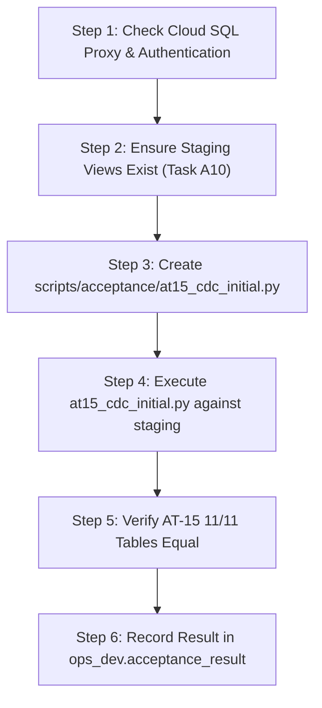

# Task A4 Completion & A5 Execution Plan Handoff

> [!NOTE]
> **Project:** Store Alert Data Lake (Phase 2) — POC A (Real-Time Path)  
> **Status:** Task A4 is **100% COMPLETE** and committed to `main` (`6adbd56`).  
> **Next Task:** Task A5 (AT-15 Acceptance Test: First-Copy Proof) & Task A10 (Staging Views Dependency).

---

## 1. Executive Summary & Context

The prior session was interrupted during the tail end of **Task A4 (Datastream CDC to BigQuery)**.
Upon resuming, the following tasks were executed and verified:
1. **Identified & Resolved Parity Snapshot Bug:** The earlier parity snapshots in `raw_g2_parity` had `0` rows across all 10 tables. The snapshot tables were dropped and re-cloned from `raw_g2`. All 10 tables now show exact row count parity (2,160 rows across the seed data).
2. **End-to-End DML & CDC Validation:** Executed `INSERT`, `UPDATE`, and `DELETE` on a scratch heartbeat record (`source = 'cdc-test'`) in Cloud SQL PostgreSQL `g2.heartbeat` via Cloud SQL Auth Proxy (`port 5433`). Verified that Datastream captured and propagated every operation into BigQuery `raw_g2.g2_heartbeat`.
3. **Event Shape & Metadata Analysis:** Confirmed that:
   - Updates arrive as **single rows** (`change_type = 'UPDATE'`), not update pairs.
   - Deletes populate **only primary keys** (`source`), with non-key columns null, adhering to PostgreSQL `REPLICA IDENTITY DEFAULT`.
   - `source_timestamp` is in milliseconds.
   - `change_sequence_number` and `sort_keys` sort consistently.
4. **Replication Latency Measurement:** Replication delay across 5 DML operations averaged **~15.4 seconds** (well within the 60s replication target and the 20-minute end-to-end SLA).
5. **Documentation & Source Control:** Updated `docs/poc2/cdc.md` with complete architecture findings, table counts, and handover notes, committed (`6adbd56`), and pushed to `main`.

---

## 2. Status of Phase 4 (Task A4) Checklist

| Step | Action | Status | Notes / Output |
|---|---|---|---|
| **4.1** | BigQuery Datasets Exist | ✅ Done | `raw_g2` & `raw_g2_parity` created in `us-central1` |
| **4.2** | Terraform Module Applied | ✅ Done | 6 resources added; stream `poc-cdc-stream` created |
| **4.3** | Backfill Completion | ✅ Done | All 11 stream objects reached `COMPLETED` |
| **4.4** | Check Initial Row Counts | ✅ Done | 2,160 rows backfilled, matching seeded database |
| **4.5** | Freeze Parity Snapshot | ✅ Done | Dropped empty snapshots and recreated 10 tables |
| **4.6** | Verify Snapshot Parity | ✅ Done | Exact 1:1 match across all tables |
| **4.7** | Announce Snapshot Taken | ✅ Done | Simulator and downstream tasks unblocked |
| **4.8** | Inspect Metadata | ✅ Done | Schema, types, and sequence number validated |
| **4.9** | Test INSERT / UPDATE / DELETE | ✅ Done | Live DML on `cdc-test` verified in BigQuery |
| **4.10** | Measure Replication Latency | ✅ Done | Observed ~15.4s average latency |
| **4.11** | Record `docs/poc2/cdc.md` | ✅ Done | Updated, committed, and pushed |

---

## 3. Data Parity Verification Table

| Table | Cloud SQL `g2` | `raw_g2` | `raw_g2_parity` | Match Status | Notes |
|---|---|---|---|---|---|
| `brands` | 4 | 4 | 4 | **MATCH** | Reference table |
| `teams` | 5 | 5 | 5 | **MATCH** | Reference table |
| `statuses` | 7 | 7 | 7 | **MATCH** | Reference table |
| `users` | 18 | 18 | 18 | **MATCH** | Reference table (PII tagged in D9) |
| `alert_types` | 11 | 11 | 11 | **MATCH** | Reference table |
| `stores` | 41 | 41 | 41 | **MATCH** | Includes probe store `S999` |
| `device_locations` | 133 | 133 | 133 | **MATCH** | Includes probe device `D999` |
| `alert_incidents` | 450 | 450 | 450 | **MATCH** | Seed incidents |
| `alert_history` | 1,490 | 1,490 | 1,490 | **MATCH** | Seed history entries |
| `heartbeat` | 1 | 4* | 1 | **MATCH** | *`raw_g2` holds 1 initial + 3 `cdc-test` test rows; parity has 1 frozen |
| `store_access` | 0 | 0 | 0 | **MATCH** | Empty at seed; Datastream creates table on first insert |
| **Total Baseline** | **2,160** | **2,160** | **2,160** | **MATCH** | Exact baseline preserved |

---

## 4. Key Architectural Findings for Downstream Developers

> [!IMPORTANT]
> **For Dev 3 (Task A10 - Staging Views):**
> 1. **DML Shapes:** `UPDATE` operations produce a single row with `change_type = 'UPDATE'`. The staging macro `cdc_current_state()` does **not** need to handle synthetic `UPDATE-DELETE`/`UPDATE-INSERT` split pairs.
> 2. **Soft Deletes:** `DELETE` operations only carry the primary key columns (e.g. `source`). All non-key fields are null. The macro must use `qualify row_number() over (partition by <keys> order by _source_updated_at desc, _seq desc) = 1` across non-deleted rows to retain the last-known state, while propagating `is_deleted = true`.
> 3. **Timestamps:** `source_timestamp` is an integer millisecond timestamp. Convert via `TIMESTAMP_MILLIS(datastream_metadata.source_timestamp)`.

> [!TIP]
> **For Dev 1 (Task C4 - Parity Testing):**
> Run dbt with `--vars '{g2_raw_dataset: raw_g2_parity}'` to run models against the frozen snapshot independently of ongoing simulator activity.

---

## 5. Execution Roadmap for Task A5 (AT-15 First-Copy Proof)

Task A5 validates acceptance test **AT-15**: proving that the initial CDC copy matches the source database key-for-key across all 11 tables.

### Dependency Note
Task A5 queries:
```sql
SELECT COUNT(*) FROM `<stg_dataset>.stg_g2__<table>` WHERE NOT is_deleted
```
Because `stg_g2__*` staging views are defined in **Task A10** (Phase 5), A5 execution is performed either:
1. Immediately after Dev 3 implements the Task A10 staging models (`dbt/models/staging/g2/`).
2. Or as part of A5 using a standalone test staging schema/models if verifying independently ahead of full A10 merge.

### Step-by-Step Instructions for A5:



#### Step 1: Verify Prerequisites
- Ensure Cloud SQL Auth Proxy is running (`port 5433`).
- Confirm PostgreSQL credentials can be retrieved from Secret Manager: `poc-ops-db-postgres`.

#### Step 2: Implement Acceptance Script `scripts/acceptance/at15_cdc_initial.py`
The script must implement the following logic:
- Accept argument `--stg-dataset` (e.g. `stg_dev` or `dbt_<user>_stg`).
- Pause Cloud Scheduler job `poc-simulator-tick` (if active).
- Flush a fresh heartbeat to `g2.heartbeat` in Postgres:
  ```sql
  UPDATE g2.heartbeat SET beat_at = now() WHERE source = 'simulator' RETURNING beat_at;
  ```
- Wait until that timestamp appears in `raw_g2.g2_heartbeat` (verifies zero replication lag).
- For each of the 11 tables (`brands`, `teams`, `statuses`, `users`, `alert_types`, `stores`, `device_locations`, `alert_incidents`, `alert_history`, `store_access`, `heartbeat`):
  - Query PG: `SELECT COUNT(*) FROM g2.<table>;`
  - Query BQ: `SELECT COUNT(*) FROM <stg_dataset>.stg_g2__<table> WHERE NOT is_deleted;`
  - Assert `pg_count == bq_count`.
- Resume Cloud Scheduler.
- Return exit code 0 if all 11 match, 1 otherwise.

#### Step 3: Run Acceptance Test
```bash
python scripts/acceptance/at15_cdc_initial.py --stg-dataset <dataset_name>
```

#### Step 4: Record Gate G6 Evidence
Log the test execution output into `ops_dev.acceptance_result` and update the test matrix in `docs/poc2/runbook.md`.
